# Apollo Watchdog SW Implementation Report

## 1. Overview

### 1.1 Purpose and Scope

Apollo Hardware Watchdog의 register·출력 배선, QVP 모델, Domain별 driver·feeding·만료 처리·복구를 설명한다.

- **시스템 용도:** SW의 HW refresh가 중단되면 watchdog IP가 만료를 검출하고 interrupt·reset을 요청한다.
- **대상:** AP Linux·TF-A, SI CL0 SCP·CL1 Zephyr, RSE TF-M.
- **범위:** Platform Generic/Timestamp watchdog, CMSDK SLOWCLK 및 SAM 내부 HW watchdog의 설정·서비스·만료 경로.

### 1.2 Watchdog Summary

**Watchdog 만료와 시스템 복구는 별도 단계다.** AP NS watchdog은 WS1 interrupt 이후 SCP·TF-M의 협력으로 AP를 재기동한다.

| Domain | Hardware Watchdog | 현재 SW 역할 |
|---|---|---|
| AP | NS / Secure platform watchdog | Linux NS feeding, TF-A Secure helper·error path |
| SI CL0 | CL0 platform watchdog | AP HW watchdog WS1 복구; local feeding 서비스 미확인 |
| SI CL1 | 전용 HW watchdog instance 없음 | Zephyr WDT API 제공; Apollo HW binding 없음 |
| RSE | NS / Secure timestamp watchdog | Timestamp feeding 서비스 미확인; SLOWCLK driver·SAM 설정 존재 |

### 1.3 Glossary

| 용어 | 의미 |
|---|---|
| Refresh / Feeding | WRR 등에 접근해 watchdog 감시 구간 갱신 |
| WOR / WCV / WCS | Watchdog Offset / Compare Value / Control and Status |
| WS0 / WS1 | 첫 번째 / 두 번째 watch period 만료 출력 |
| Control / Refresh frame | 설정·상태 register / 서비스용 refresh register 영역 |
| Timeout / Recovery | 만료 조건 / 만료 후 수행하는 복구 정책 |
| nowayout / Magic close | 시작 후 stop 제한 / 특별한 close sequence로 stop 허용 |
| QVP / FVP | Apollo QBox Virtual Platform / Arm Fixed Virtual Platform |

## 2. Hardware Architecture

### 2.1 System Architecture — Automotive AD System

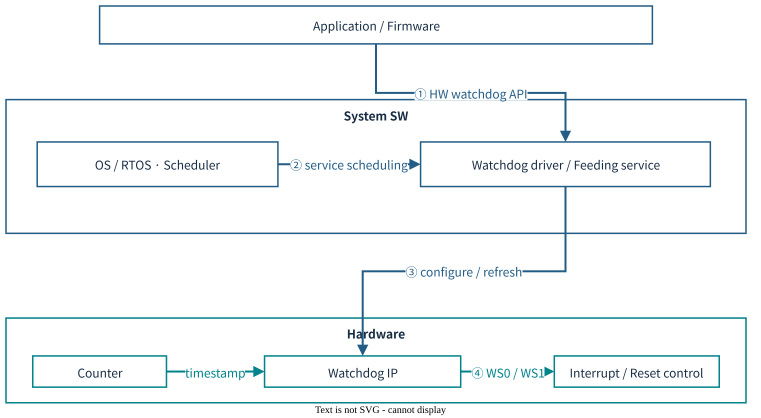

- **System SW:** Application·firmware가 driver API로 HW watchdog을 설정·enable하고 주기적으로 refresh한다.
- **Hardware:** Counter 기반 기한이 지나면 WS0·WS1을 출력한다.
- **복구:** Interrupt handler·관리 firmware·reset controller가 설정된 복구 범위를 수행한다.

### 2.2 Watchdog Hardware

Timestamp와 deadline을 비교하고, 첫 만료에서 WS0, 다음 구간 만료에서 WS1을 출력한다. Refresh는 감시 구간을 다시 시작한다. WS1의 최종 interrupt·reset 대상은 SoC 통합 정책을 따른다.

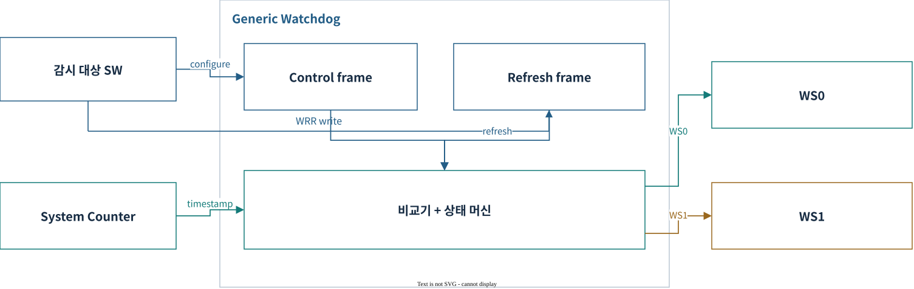

**Control / Refresh Register 구조**

| Frame / offset | Register | 역할 |
|---|---|---|
| Control +0x000 | WCS | EN·WS0·WS1 |
| Control +0x008 / +0x00C | WOR / WORU | Watch period offset; QVP 총 48-bit |
| Control +0x010 / +0x014 | WCV / WCVU | 64-bit deadline |
| Refresh +0x000 | WRR | Explicit refresh |

### 2.3 AP Domain Watchdog

AP의 NS·Secure watchdog은 CPU들이 공유하는 장치다. **HW AP 16 PE에도 platform watchdog은 2개**이며 CPU별 Timer PPI와 다르다.

#### 2.3.1 AP Domain Watchdog Hardware

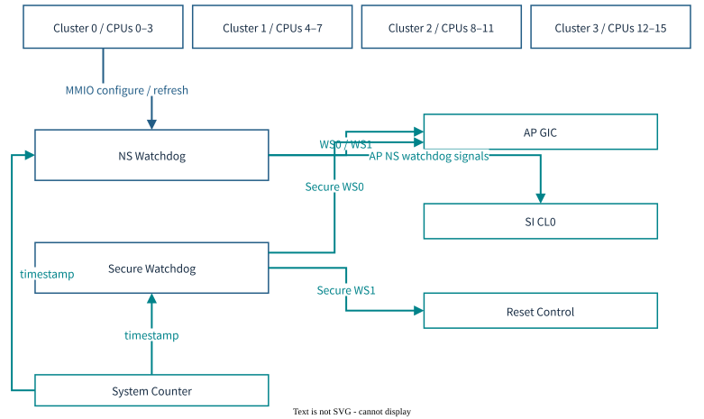

**Register map — AP shared watchdog**

| 장치 | Control base | Refresh base | 용도 |
|---|---|---|---|
| Non-secure | `0x1A420000` | `0x1A430000` | Linux watchdog |
| Secure | `0x1A460000` | `0x1A470000` | Secure firmware용 watchdog |

**Interrupt / reset map — 현재 QVP**

| Source | 출력 대상 | 처리 |
|---|---|---|
| AP NS WS0 | AP INTID82 | Linux 기본 action=0에서는 WS0 ISR 미등록 |
| AP NS WS1 | AP INTID83 + CL0 INTID321 | CL0 firmware가 AP 복구 수행 |
| AP Secure WS0 | AP INTID79 | Secure interrupt 경로 |
| AP Secure WS1 | Host reset controller | AP reset 요청 |

#### 2.3.2 Watch Period / Expiry Flow

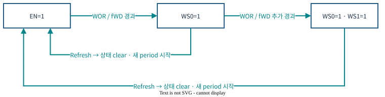

도면 상세 설명

- **EN=1**: EN=1 / WS0=0 · WS1=0
- **WOR / fWD 경과**: WOR / fWD 경과 / WS0 assert · 다음 deadline 설정
- **WOR / fWD 추가 경과**: WOR / fWD 추가 경과 / WS1 assert · WS0 유지

1. WOR·EN을 설정하면 감시를 시작한다.
2. 정상 refresh가 없으면 첫 구간 뒤 WS0를 assert한다.
3. 추가 한 구간이 지나면 WS1도 assert한다.
4. Refresh 또는 disable/reset으로 source 상태를 해제한다. GIC EOI만으로 WS level은 내려가지 않는다.

Refresh는 WRR·WOR 또는 WCS.EN=1 write로 수행한다. Linux의 WOR 설정은 `action=0`에서 `timeout × CNTFRQ / 2`, `action=1`에서 `timeout × CNTFRQ`다.

Linux 기본 `action=0`은 두 구간을 합쳐 timeout을 구성한다. Counter와 watchdog frequency가 같을 때 timeout 20초는 WS0 약 10초·WS1 약 20초의 논리 기한이다. `action=1`은 한 구간 timeout과 WS0 panic을 사용한다.

#### 2.3.3 AP Domain Watchdog QVP 구현

| 구성 | 구현 |
|---|---|
| Model | `ap_watchdog_0`, `ap_secure_wdog`: SystemC `zena_watchdog` |
| Timebase | 각각 125MHz 설정의 SystemC time 환산; CSS counter와 별도 |
| MMIO | `ap_router`의 Control / Refresh target |
| WS1 처리 | NS는 AP·CL0 fanout, Secure는 reset controller |
| Profile 차이 | `linux-direct`는 SI 복구·AP reset fanout 제거 |

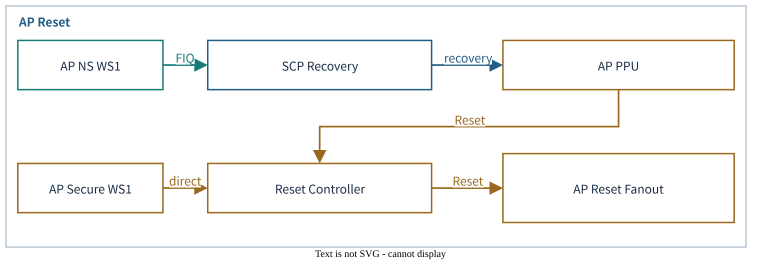

AP NS WS1은 SCP의 IRQ mask·Event 처리와 PPU 제어를 거쳐 복구한다. AP Secure WS1은 Reset Controller에 직접 연결된다. 전체 Apollo reset은 watchdog 5개를 clear하지만, RSE local SYS/RSS reset에는 watchdog이 포함되지 않는다.

AP cold-reset fanout은 NS/S watchdog을 먼저 clear한 뒤 AP reset handshake를 진행한다. NS WS1을 reset controller에 직접 연결한 구성으로 설명하지 않는다.

### 2.4 Safety Island Domain Watchdog

#### 2.4.1 CL0 System Watchdog Hardware

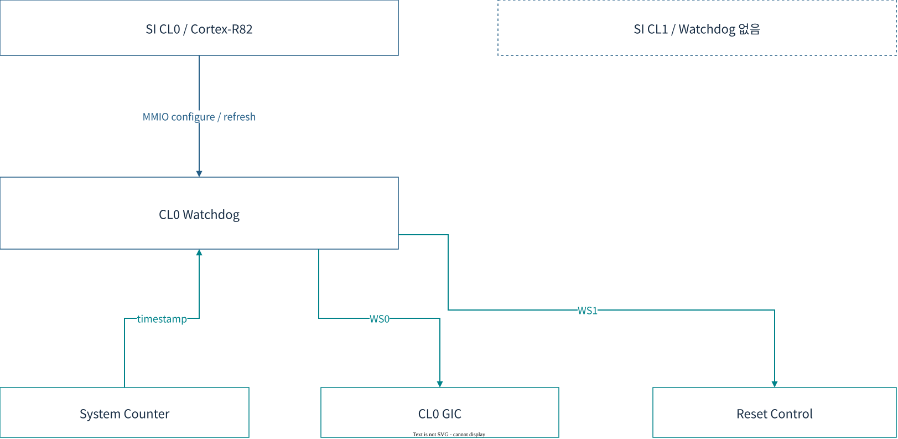

CL0는 공유 system watchdog을 가진다. 현재 CL1에는 전용 HW watchdog instance와 driver binding이 없다.

**Register / interrupt map**

| 항목 | 주소 / 출력 | 역할 |
|---|---|---|
| CL0 Control / Refresh | `0x2A700000` / `0x2A710000` | WCS·WOR·WCV / WRR |
| CL0 WS0 | CL0 INTID37 | Local watchdog interrupt |
| CL0 WS1 | Reset controller의 SI watchdog input | `EXP0RESETEN` bit24 gate |
| AP NS WS1 입력 | CL0 INTID321 | AP watchdog 복구용; CL0 local WS0와 별도 |

**Expiry Flow:** CL0 deadline → WS0 → 추가 구간 → WS1 → reset gate. 현재 QVP는 controller의 `si_reset` 출력이 미연결이므로 이 경로의 SI 재기동을 구현 완료로 간주하지 않는다.

#### 2.4.2 Safety Island Domain Watchdog QVP 구현

| 구성 | CL0 | CL1 |
|---|---|---|
| Platform watchdog | `si_cl0_watchdog` | 전용 instance 없음 |
| Model timebase | 125MHz SystemC time | 해당 없음 |
| HW watchdog 처리 | AP WS1 복구 | 연결된 HW watchdog 없음 |
| 직접 feeding | 주기적 CL0 WRR 서비스 미확인 | 직접 HW WRR 서비스 없음 |

CL0 local watchdog의 만료와 AP watchdog WS1의 수신·복구는 서로 다른 HW 경로다.

### 2.5 RSE Domain Watchdog

#### 2.5.1 Timestamp Watchdog Hardware

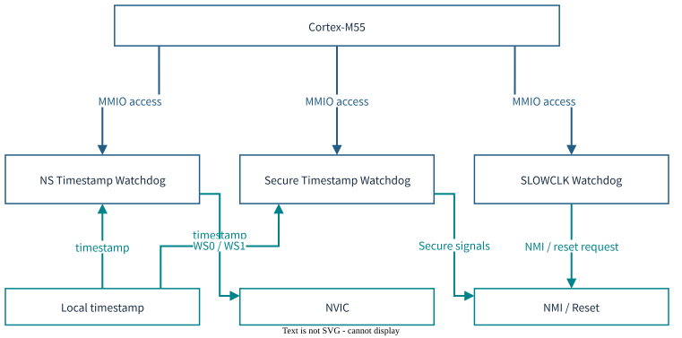

QVP Timestamp watchdog 2개는 32MHz 설정이다. NS 출력만 NVIC IRQ1/IRQ0에 연결되며, Secure 출력은 미연결이다. Timestamp·SLOWCLK·SAM 내부 watchdog은 서로 다른 IP다.

RSE timestamp watchdog은 NS·Secure 두 개이며 Local timestamp를 사용한다. SLOWCLK watchdog과 SAM 내부 watchdog은 다른 IP다.

**Register / interrupt map**

| 장치 | Control / Refresh base | HW 역할 / 현재 QVP |
|---|---|---|
| NS timestamp watchdog | `0x48040000` / `0x48041000` | QVP WS0→NVIC IRQ1, WS1→IRQ0 |
| Secure timestamp watchdog | `0x58040000` / `0x58041000` | Reference의 NMI/reset 경로; QVP 출력 미연결 |
| CMSDK SLOWCLK watchdog | `0x5802E000` | 별도 countdown·NMI/cold-reset source; QVP device 없음 |

Timestamp 장치는 Control·Refresh frame을 사용한다. CMSDK SLOWCLK의 LOAD·LOCK·INTCLR register 계약을 timestamp watchdog에 적용하지 않는다.

#### 2.5.2 Reset / Security Integration

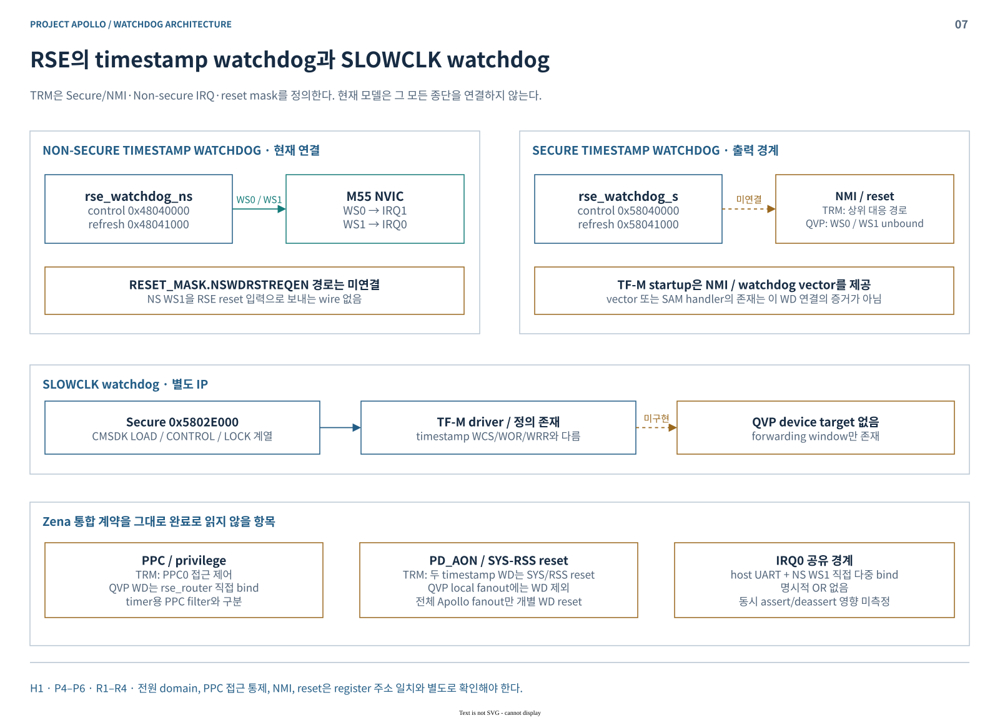

NS watchdog의 WS0/WS1은 NVIC IRQ1/IRQ0에 연결된다. Secure 출력과 NS reset mask 경로는 미연결이며, SLOWCLK device 모델은 없다. IRQ0는 Host UART와 NS WS1이 공유하고 명시적인 OR 모델이 없어 동시 신호 영향은 별도 확인 대상이다.

- **HW 통합:** Timestamp watchdog의 PPC0·PD_AON·SYS/RSS reset 규칙을 따른다.
- **NS 만료:** QVP는 IRQ0/1까지만 연결하며 `NSWDRSTREQEN` reset gate까지 연결하지 않는다.
- **Secure 만료:** NMI·reset downstream이 연결되지 않았다.
- **Access / reset 차이:** 현재 watchdog에 PPC filter가 없고 local SYS/RSS fanout에도 제외되어 있다.

IRQ0에는 host UART도 직접 bind되어 있다. 명시적 OR 합성이 없으므로 독립 source의 동시 assert/deassert는 단일 source 시험과 구분한다.

#### 2.5.3 RSE Domain Watchdog QVP 구현

| 항목 | 구현 |
|---|---|
| Model | `rse_watchdog_ns` / `rse_watchdog_s`, SystemC `zena_watchdog` |
| Frequency | 각 32MHz 설정; timestamp HW의 실제 clock 배선과 구분 |
| MMIO | `rse_router`의 4KiB Control·Refresh frame |
| Reset | 전체 Apollo reset fanout에서 clear; local SYS/RSS reset과 범위 차이 |
| SW 사용 | Timestamp WD 주기적 arm/feed 서비스 미확인 |

### 2.6 Subsystem별 HW 구성 요약

| Domain | Watchdog 구성 | 감시 단위 | 대표 출력 |
|---|---|---|---|
| AP | NS + Secure 2개 | AP CPU들이 공유 | AP IRQ·CL0 IRQ·AP reset |
| SI CL0 | System watchdog 1개 | CL0 공유 | Local IRQ·SI reset 요청 |
| SI CL1 | 전용 platform instance 없음 | 해당 없음 | 해당 없음 |
| RSE | NS + Secure timestamp 2개 | M55 system | NVIC IRQ·참조 NMI/reset 경로 |

## 3. QVP Watchdog Implementation

### 3.1 Implementation Overview

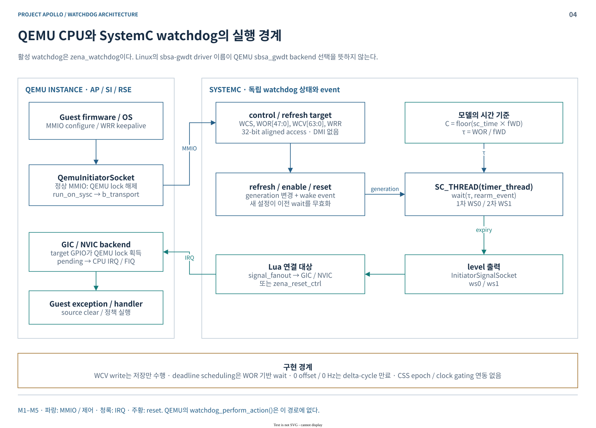

| 계층 | 실제 책임 |
|---|---|
| QEMU CPU / QBox initiator | guest load/store를 TLM MMIO로 전달; 정상 경로는 QEMU lock을 놓고 SystemC로 전환 |
| `zena_watchdog` | register·stage·generation·deadline wait 소유; `SC_THREAD(timer_thread)`가 만료 처리 |
| `signal_fanout` / Lua bind | WS 출력의 AP·SI 분배 또는 reset controller 연결 |
| QEMU GIC / NVIC | target instance lock 아래 GPIO 입력 처리; pending·priority·CPU exception 수행 |
| SCP / TF-M | timeout에 따른 복구 정책, firmware 재적재와 ACK 처리 |

현재 5개 장치는 모두 **SystemC `zena_watchdog`**다. QEMU `sbsa_gwdt`와 `cmsdk-apb-watchdog` 소스도 존재하지만 이 구성에서 선택하지 않는다. 따라서 QEMU의 `watchdog_perform_action()`을 현재 Apollo의 WS1 동작으로 설명하면 안 된다. [모델·bridge 근거](SOURCES.md#models)

### 3.2 Expiry / Refresh / Cancellation

- 한 구간: `τ = ((WORU & 0xffff) << 32 | WOR) / fWD`.
- `SC_THREAD`는 `τ` 또는 rearm event를 기다린다. refresh/reset 시 generation을 바꿔 이전 wait를 무효화한다.
- 첫 만료: WS0를 올리고 WCV를 다음 구간의 deadline으로 갱신한다. 둘째 만료: WS1도 올린다.
- disable/reset: 두 출력을 내리고 pending wait를 무효화한다. Reset 유지 중 write는 무시한다.

**WCV는 현재 모델에서 scheduling source가 아니다.** 직접 WCV를 써도 예약은 바뀌지 않는다. 0 offset 또는 0 Hz는 정지 clock 대신 delta-cycle 만료로 처리한다. [register 상세](WATCHDOG-MAP.md#registers)

Linux `GETTIMELEFT`는 WCV에서 CPU generic counter를 뺀다. QVP watchdog과 CPU counter는 시간 소유자가 다르므로 **같은 125MHz 설정만으로 epoch·위상 일치를 보장하지 않는다**. `GETTIMELEFT` 검증은 실제 감소·refresh 후 회복을 함께 확인한다.

### 3.3 Arm Reference / QVP Comparison

Arm 설계의 Hardware Watchdog register·clock·interrupt·reset 계약과 현재 QVP 구성의 차이를 정리한다.

| 비교 항목 | Arm reference 계약 | 현재 Apollo QVP |
|---|---|---|
| Timebase | System Counter timestamp 기반 | watchdog별 `SystemC time × frequency`; CSS mirror와 독립 |
| AP NS 만료 | WS0·WS1 interrupt, 상위 SW 대응 | WS0→AP, WS1→AP+CL0; SCP가 복구 수행 |
| SI의 AP WD 입력 | INTID320–323 정의 | **NS WS1의 INTID321만 연결** |
| SI CL0 reset | system watchdog과 reset 제어 | WS1→controller까지 연결; `si_reset` 출력 미연결 |
| RSE 보호 | NS IRQ·reset mask, Secure/SLOWCLK NMI | NS IRQ0/1 연결; Secure 출력 미연결, SLOWCLK device 부재 |
| 접근·reset domain | RSE PPC0, PD_AON, SYS/RSS reset | watchdog PPC filter 없음; local SYS/RSS fanout에 WD 제외 |

Arm의 watchdog validation은 장치·driver·filesystem 접근 확인이며, expiry/recovery와 별도 항목이다. [참조 설계](SOURCES.md#reference)

## 4. Watchdog Software Architecture

### 4.1 Software Architecture Overview

| 계층 | 책임 | Watchdog과의 관계 |
|---|---|---|
| Application / firmware | HW watchdog 설정·start·주기적 refresh | Driver를 통해 HW register 갱신 |
| OS / RTOS Scheduler | Feeding Thread 실행 | HW counter는 Thread와 독립적으로 진행 |
| Driver / framework | timeout·start·refresh·stop | HW frame 접근과 정책 적용 |
| Interrupt handler | 만료 통보·source 처리·event 게시 | AP 복구의 긴 handshake는 ISR 밖에서 수행 |
| Management firmware | 격리·재적재·재시작 | SCP가 AP OFF/ON, TF-M이 BL2 검증 |

Driver probe, watchdog enable, 실제 feeding owner는 다른 상태다. HW watchdog이 enable된 뒤에는 정해진 기한 안에 refresh해야 한다.

### 4.2 AP Domain — Linux·TF-A

#### 4.2.1 Linux Watchdog Architecture

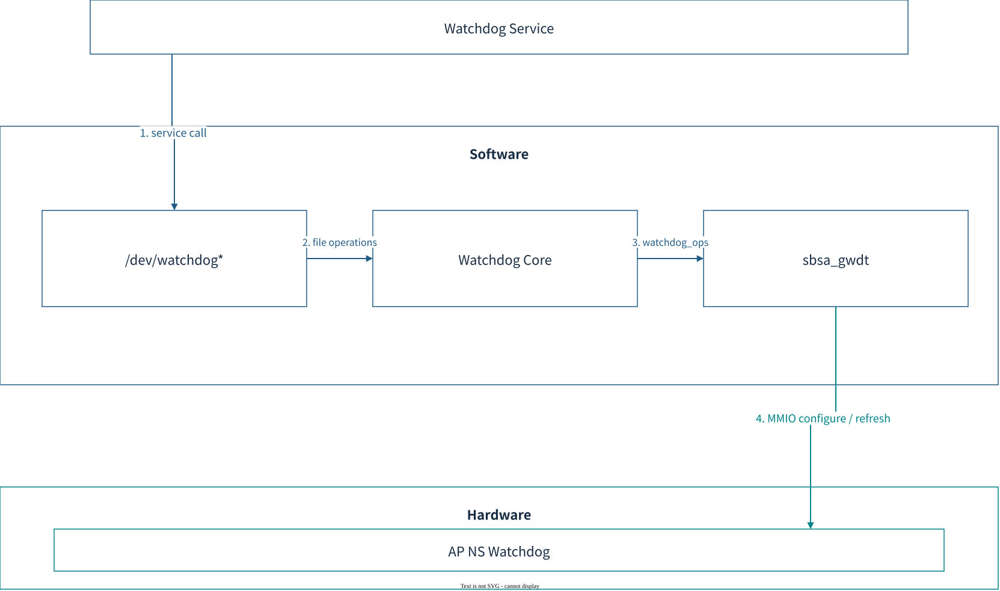

Linux는 NS watchdog을 `arm,sbsa-gwdt`로 probe하고 `/dev/watchdog*`를 제공한다. 서비스가 장치를 열고 `write()` 또는 `WDIOC_KEEPALIVE`로 refresh한다. Scheduler는 서비스 실행을 지원하고 watchdog core는 nowayout·close·HW keepalive 정책을 적용한다.

##### 4.2.1.1 Watchdog Initialization

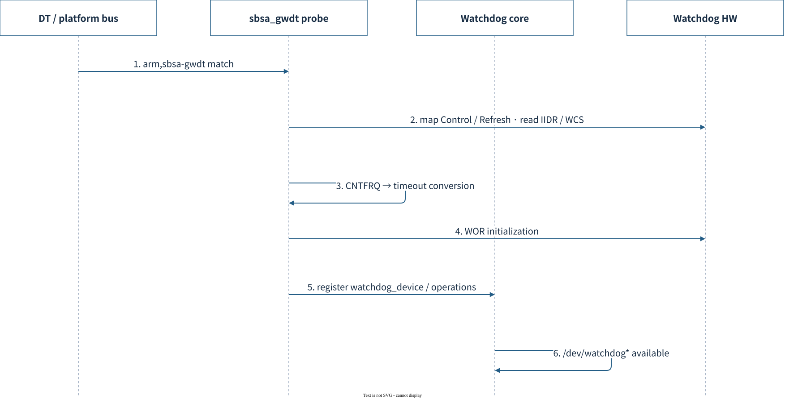

Driver probe는 feeding service 시작과 다르다. Probe 시 WCS.EN이 설정되어 있으면 이미 동작 중인 Hardware로 처리한다.

1. DT compatible로 `sbsa_gwdt` driver를 선택한다.
2. Control·Refresh MMIO를 map하고 IIDR·WCS 상태를 읽는다.
3. `arch_timer_get_cntfrq()`로 timeout 환산 기준을 얻는다.
4. Timeout을 WOR에 반영한다. 이미 enable된 HW에서는 이 write가 refresh 효과를 갖는다.
5. Watchdog operations와 `watchdog_device`를 core에 등록한다.
6. `/dev/watchdog*`에서 서비스 요청을 받는다.

`action=1`일 때 WS0 IRQ를 요청하며 등록 실패 시 action=0으로 돌아간다. 기본 action=0에는 WS0 panic ISR이 없다. [Linux driver·DT](SOURCES.md#linux)

##### 4.2.1.2 Watchdog API

| API / 동작 | Driver / register | 의미 |
|---|---|---|
| `open()` / start | `sbsa_gwdt_start()` → WCS.EN | 감시 활성화 |
| `WDIOC_SETTIMEOUT` | `sbsa_gwdt_set_timeout()` → WOR | action=0은 `CNTFRQ/2 × timeout`, action=1은 `CNTFRQ × timeout` |
| `write()` / `WDIOC_KEEPALIVE` | `sbsa_gwdt_keepalive()` → WRR | Stage clear·감시 재시작 |
| `WDIOC_GETTIMELEFT` | WCV−CPU counter; 첫 stage에서 WOR 추가 | Watchdog과 CPU counter의 시간 기준 일치 필요 |
| Stop / magic close | WCS.EN clear | nowayout·core 정책 적용 |

비정상 close는 HW stop 또는 feeding 중단과 같지 않다. Kernel core가 watchdog을 유지하거나 ping할 수 있으므로 expiry 시험은 FD를 유지한 채 feeding을 중단한다.

##### 4.2.1.3 Feeding / Expiry Sequence

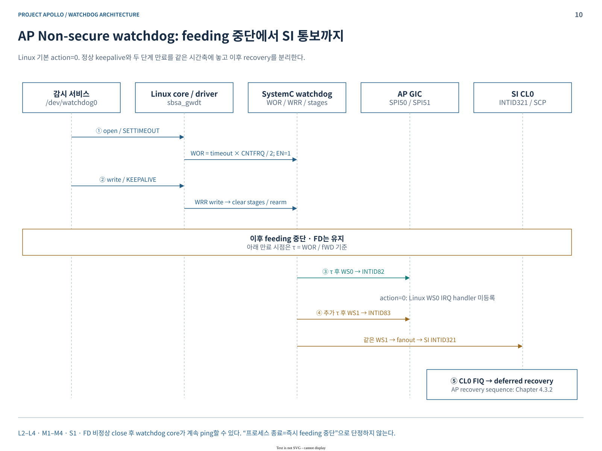

이 흐름은 Linux `action=0` 기준이다. WS0 ISR은 등록하지 않으며, WS1은 CL0 INTID321로 전달된다. FD의 비정상 close 이후에도 watchdog core가 ping할 수 있으므로 프로세스 종료와 feeding 중단을 구분한다.

1. 서비스가 timeout을 설정하고 watchdog을 시작한다.
2. 정상 상태에서는 WRR write를 반복해 두 stage를 clear한다.
3. Feeding이 중단되면 WS0가 AP INTID82로 전달된다.
4. 두 번째 구간이 지나면 WS1이 AP INTID83·CL0 INTID321로 전달된다.
5. 기본 action=0의 복구 주체는 SCP다. AP interrupt 발생만으로 Linux가 재부팅을 완료한 것은 아니다.

#### 4.2.2 TF-A Secure Watchdog Architecture

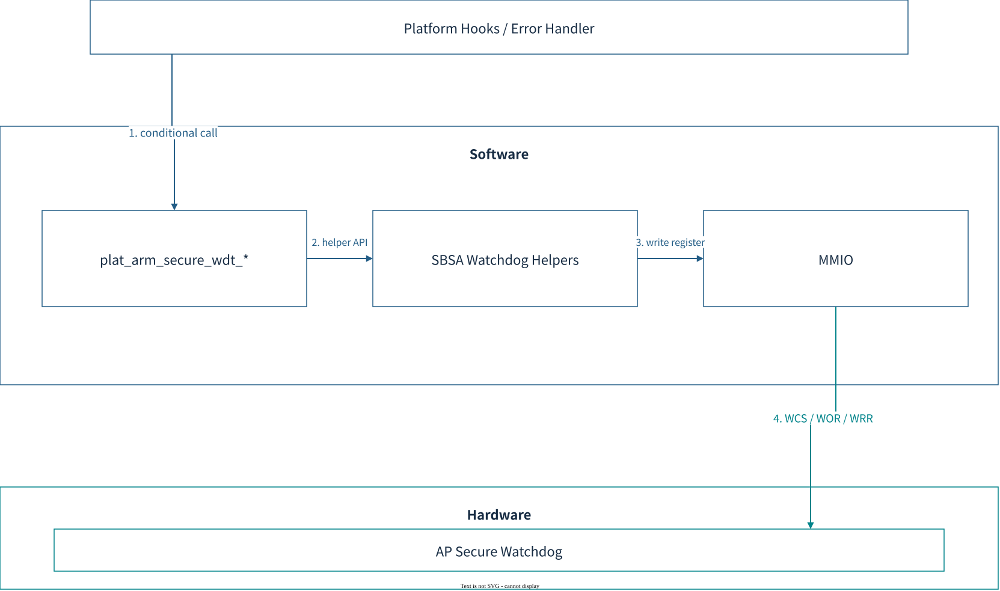

##### 4.2.2.1 Configuration / Helper API

| 항목 | 구현 |
|---|---|
| Start | `plat_arm_secure_wdt_start()` → WOR 설정·WCS.EN |
| Timeout 상수 | 100ms; 한 watch period 설정값 |
| Stop | `plat_arm_secure_wdt_stop()` → WCS=0 |
| Apollo boot 선택 | `NEED_BL1=0`, `RESET_TO_BL2=1` |
| Error path | `plat_arm_error_handler()` → `sbsa_wdog_refresh()` 후 WFI |

공통 BL1의 start/stop 호출은 Apollo 정상 boot의 watchdog 활성화 근거가 아니다. U-Boot·Linux로 이어지는 자동 feeding 체인으로 설명하지 않는다.

##### 4.2.2.2 Error Handler Sequence

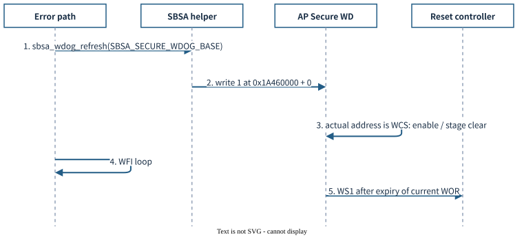

1. Error handler가 `sbsa_wdog_refresh(SBSA_SECURE_WDOG_BASE)`를 호출한다.
2. Helper가 전달된 base+0에 1을 쓴다.
3. 현재 base는 Refresh frame이 아닌 **Control `0x1A460000`**이므로 QVP에서는 WCS.EN write·stage clear로 처리한다.
4. Error handler는 WFI loop에 남는다.
5. 현재 WOR에 따른 만료가 진행되면 Secure WS1이 AP reset controller로 전달된다.

함수 이름과 실제 register 접근을 구분한다. 이 경로가 WOR를 새로 설정하거나 항상 100ms를 보장하는 것은 아니다. [TF-A 소스](SOURCES.md#ap-firmware)

### 4.3 Safety Island CL0 — SCP Watchdog Architecture

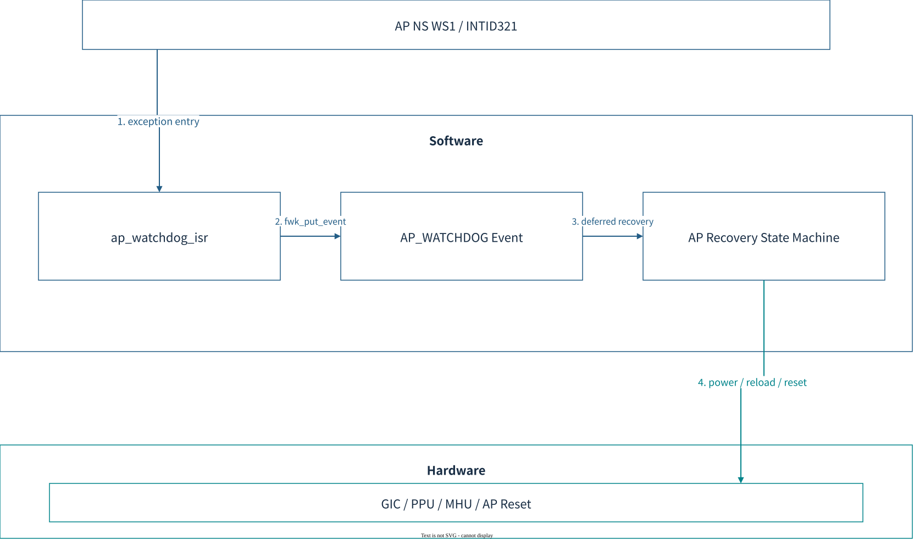

#### 4.3.1 Interrupt Initialization / Recovery Policy

AP NS WS1은 `ap_watchdog_irq=321`로 등록한다. `ap_watchdog_isr()`는 level interrupt를 mask하고 recovery latch를 설정한 뒤 `AP_WATCHDOG` event를 게시한다.

| 처리 문맥 | 동작 |
|---|---|
| FIQ ISR | IRQ mask·중복 방지·`fwk_put_event()` |
| Framework event | AP 전원 상태 전환과 RSE reload 시작 |
| Timer alarm | 10ms 간격으로 진행 상태·deadline 확인 |
| IRQ rearm | Pending clear·readback·latch 해제·enable·재확인 |

CL0 local watchdog을 주기적으로 feed하는 서비스와 AP NS 만료 복구는 별도 기능이다.

#### 4.3.2 SCP Watchdog Sequence

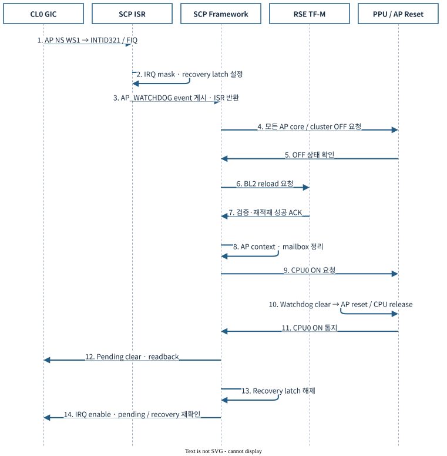

INTID321은 WS1 source가 해제될 때까지 mask를 유지한다. IRQ rearm과 Linux boot 완료는 별도 상태다.

1. AP NS WS1이 CL0 INTID321/FIQ로 전달된다.
2. ISR이 IRQ를 mask하고 recovery latch를 설정한다.
3. `AP_WATCHDOG` event를 게시하고 ISR에서 반환한다.
4. Framework가 모든 AP core·cluster의 OFF를 요청한다.
5. OFF 상태를 확인한다.
6. RSE에 BL2 reload를 요청한다.
7. 검증·재적재 성공 ACK를 받는다.
8. AP 실행 context·mailbox·SCMI·SDS 상태를 정리한다.
9. CPU0 ON을 요청한다.
10. Reset 경로가 watchdog을 clear한 뒤 AP reset·CPU release를 수행한다.
11. CPU0 ON 통지를 받는다.
12. IRQ pending을 clear하고 readback한다.
13. Recovery latch를 해제한다.
14. IRQ를 enable하고 pending·recovery 상태를 재확인한다.

전체 control budget 30초, RSE reload 10초, IRQ rearm 100ms는 SW deadline이다. 실패 시 AP OFF·IRQ masked 상태를 유지한다. IRQ rearm 성공과 새 Linux boot 완료는 다른 완료 조건이다. [SCP 복구 소스](SOURCES.md#scp)

### 4.4 Safety Island CL1 — Zephyr Watchdog Architecture

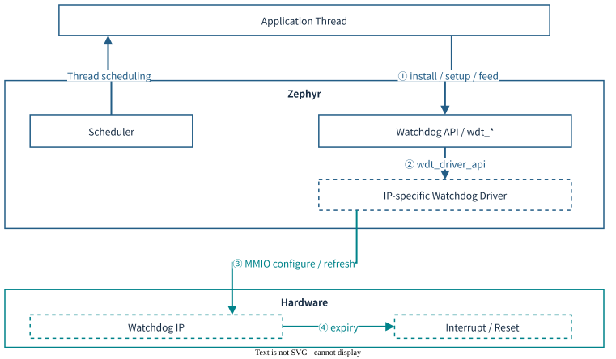

Zephyr는 공통 Watchdog API를 IP별 driver의 `wdt_driver_api`에 연결한다. Application Thread가 timeout을 설정하고 주기적으로 feed하며, HW가 만료를 감지해 지원하는 interrupt 또는 reset을 발생시킨다.

**Apollo CL1:** 현재 board DT와 QVP CL1 구성에는 전용 HW watchdog node·instance가 없다. 아래는 Zephyr API 구조이며 실제 CL1에 연결된 watchdog driver 경로는 아니다. CL0 watchdog을 CL1 전용 장치로 간주하지 않는다.

#### 4.4.1 Device / Driver Initialization

| 단계 | 역할 |
|---|---|
| Device Tree / Kconfig | 사용할 watchdog IP·MMIO·IRQ 및 driver 선택 |
| Device initialization | IP별 driver가 register·clock·interrupt를 초기화 |
| Application | `device_is_ready()` 확인 후 timeout 설치 |
| Scheduler | Feeding Thread 실행; HW timeout은 Thread와 독립적으로 진행 |

CMSDK watchdog driver의 존재만으로 Apollo의 Generic Watchdog을 사용할 수 있는 것은 아니다. IP register 계약과 board 연결이 일치해야 한다.

#### 4.4.2 Watchdog API

| API / 설정 | 역할 |
|---|---|
| `wdt_install_timeout(dev, cfg)` | Timeout window·callback·reset flags 설치; 성공 시 channel ID 반환 |
| `wdt_setup(dev, options)` | 설치한 timeout 활성화; 이후 주기적인 feed 필요 |
| `wdt_feed(dev, channel_id)` | 지정 channel의 감시 구간 갱신 |
| `wdt_disable(dev)` | Disable과 timeout 해제; HW에 따라 금지되거나 재시작 불가 |
| `window.min / max` | Feed 허용 구간(ms); window 미지원 IP는 min=0 |
| `WDT_FLAG_RESET_*` | NONE / CPU_CORE / SOC 요청; driver의 지원 범위에 따름 |

`wdt_install_timeout()`은 `wdt_setup()` 전에 호출한다. Callback·window·다중 channel·reset 종류는 모든 watchdog이 지원하는 기능이 아니므로 반환값을 확인한다. API channel ID는 CPU 번호가 아니다.

#### 4.4.3 HW Watchdog Sequence

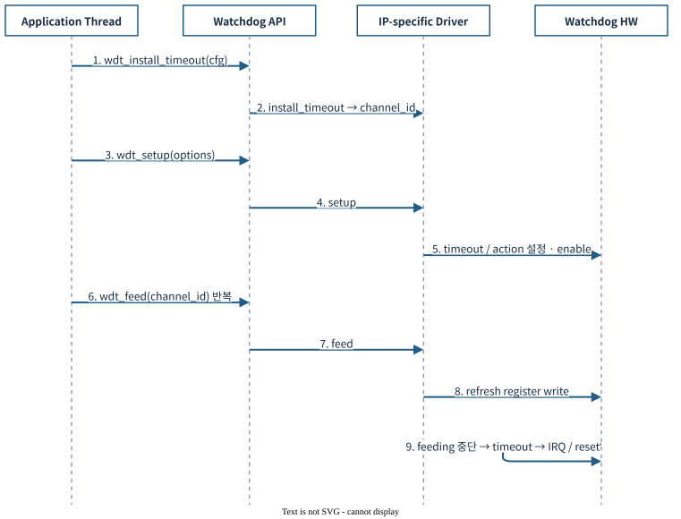

1. Application이 timeout window·callback·reset action을 설치한다.
2. API가 driver의 `install_timeout`을 호출하고 channel ID를 반환한다.
3. Application이 `wdt_setup()`을 호출한다.
4. API가 driver의 `setup`을 호출한다.
5. Driver가 IP의 timeout·action을 설정하고 감시를 시작한다.
6. Application Thread가 `wdt_feed()`를 반복 호출한다.
7. API가 driver의 `feed`를 호출한다.
8. Driver가 HW refresh register에 접근한다.
9. Feeding이 중단되면 HW가 만료되어 설정된 IRQ/reset을 발생시킨다.

Interrupt callback 지원 여부와 실행 문맥은 driver를 따른다. Timeout 후 자동 재부팅은 API만으로 보장되지 않으며 HW reset 배선이 필요하다. [Zephyr Watchdog API·driver](SOURCES.md#zephyr-watchdog)

### 4.5 RSE Domain — TF-M Watchdog Architecture

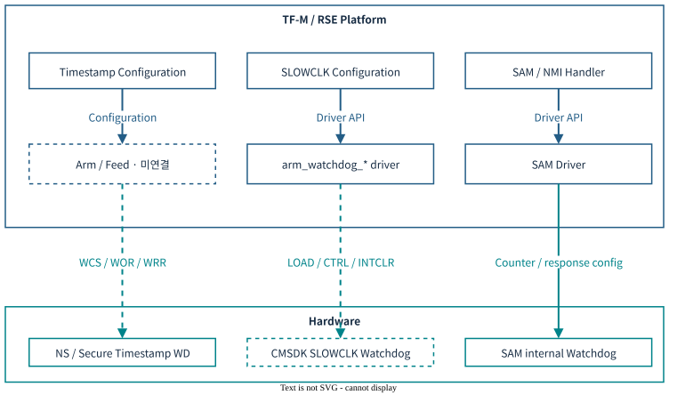

TF-M의 RSE watchdog은 **Timestamp watchdog, CMSDK SLOWCLK watchdog, SAM 내부 watchdog**으로 구분한다. 각 IP의 register·driver·만료 출력은 서로 다르다.

#### 4.5.1 Device / Driver Configuration

| 대상 | TF-M 구성 | 현재 Apollo QVP |
|---|---|---|
| NS / Secure Timestamp | Base 주소·NS watchdog vector 정의; 주기적 arm/feed 서비스 미확인 | 모델 2개 존재; NS IRQ0/1 연결, Secure 출력 미연결 |
| CMSDK SLOWCLK | `SLOWCLK_WATCHDOG_DEV_S`와 `arm_watchdog_*` driver | `0x5802E000` device 모델 없음 |
| SAM 내부 watchdog | `rse_sam_init()`에서 NMI response 감시 정책 설정 | Timestamp·SLOWCLK과 별도 IP 경로 |

NS Timestamp watchdog vector는 기본 weak handler다. CMSDK driver를 Timestamp의 WCS·WOR·WRR frame에 적용할 수 없다.

#### 4.5.2 CMSDK Watchdog Driver API

| API | Register / 상태 | 역할 |
|---|---|---|
| `arm_watchdog_init()` | Driver timeout 저장·locked / disabled | 초기 상태 구성; timeout=0이면 최대값 사용 |
| `arm_watchdog_unlock()` / `lock()` | LOCK | Register 쓰기 허용 / 차단 |
| `arm_watchdog_enable()` | LOAD·CTRL.INTEN / RESEN | Counter 시작·interrupt/reset 활성화 |
| `arm_watchdog_feed()` | LOAD 재기록 | Counter reload; interrupt clear와 별도 |
| `arm_watchdog_clear_interrupt_and_refresh_counter()` | INTCLR | Interrupt clear와 counter refresh |
| `arm_watchdog_disable()` | CTRL.INTEN / RESEN clear | 감시 중지 |
| `arm_watchdog_get_remaining_time()` | VALUE | 남은 counter 값 조회; 초 단위 환산값이 아님 |

`init()` 이후 enable 전에 unlock해야 한다. Enable은 initialized·unlocked 상태가 필요하며 feed·interrupt clear·disable은 enabled·unlocked 상태를 확인한다. 이 API의 timeout은 counter load 값이며 Linux의 초 단위 timeout과 다르다.

#### 4.5.3 HW Watchdog Sequence

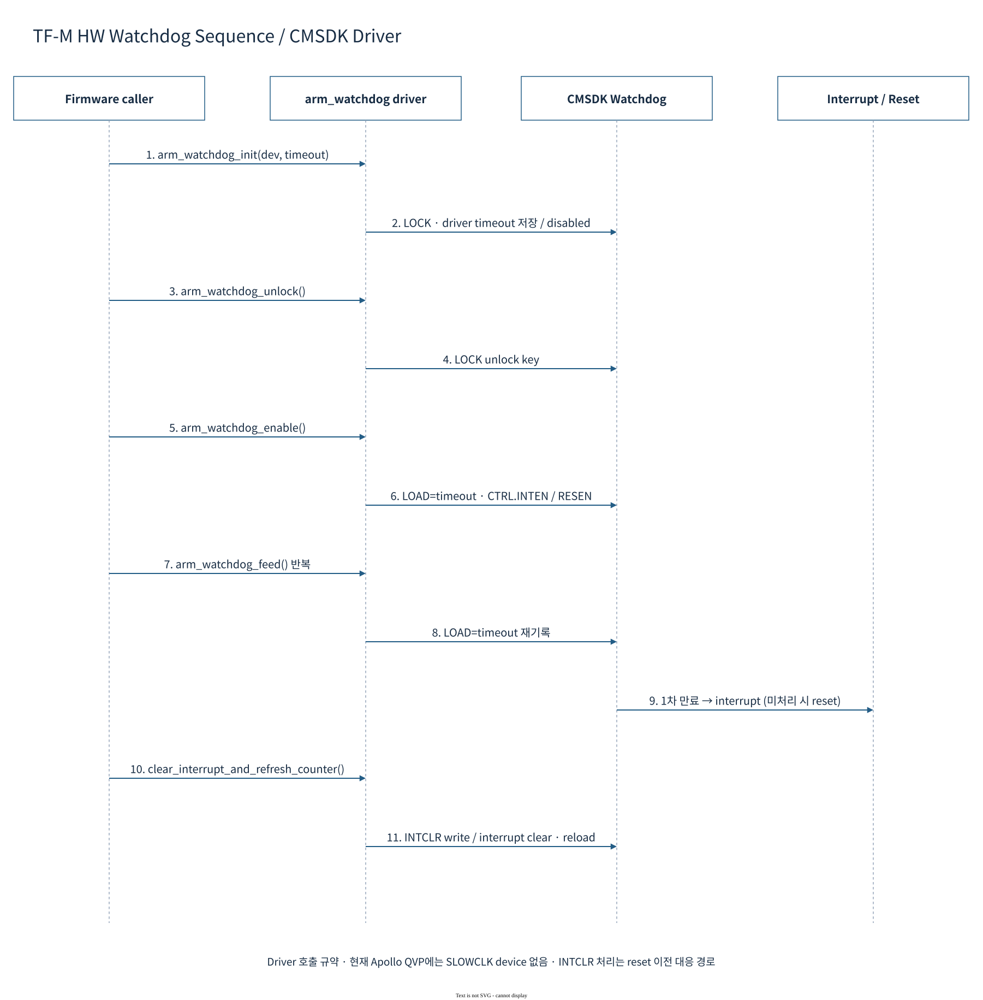

1. Firmware가 `arm_watchdog_init()`에 timeout을 전달한다.
2. Driver가 timeout을 보관하고 locked·disabled 상태로 초기화한다.
3. Firmware가 unlock을 요청한다.
4. Driver가 LOCK register에 unlock key를 쓴다.
5. Firmware가 enable을 요청한다.
6. Driver가 LOAD와 CTRL.INTEN/RESEN을 설정한다.
7. 정상 실행 중 firmware가 feed를 반복한다.
8. Driver가 LOAD에 timeout을 다시 쓴다.
9. Feeding이 중단되면 HW가 interrupt를 발생시키고, 처리되지 않으면 reset 단계로 진행한다.
10. Reset 전에 대응하는 firmware가 interrupt clear API를 호출한다.
11. Driver가 INTCLR을 써서 interrupt를 clear하고 counter를 refresh한다.

위 Sequence는 CMSDK driver의 호출 규약이다. 현재 RSE 코드에서는 `SLOWCLK_WATCHDOG_DEV_S`를 주기적으로 enable/feed하는 소비 경로가 확인되지 않으며, QVP SLOWCLK device도 없다. [TF-M Watchdog driver](SOURCES.md#tfm-watchdog)

#### 4.5.4 SAM Watchdog / NMI Policy

| 구성 | 설정 / 역할 |
|---|---|
| Counter 설정 | `sam_set_watchdog_counter_initial_value(..., 0xFF, SAM_RESPONSE_NMI)` |
| 감시 목적 | NMI 대응이 지연되는 경우를 감지 |
| 만료 정책 | `SAM_EVENT_WATCHDOG_TIMER → SAM_RESPONSE_COLD_RESET` |
| NMI handler | `sam_handle_fast_attack_counter_increment()` 호출 |

SAM watchdog은 application이 WRR을 주기적으로 갱신하는 Timestamp watchdog과 별개다. Counter 설정값을 host 시간이나 Timestamp watchdog의 32MHz 주기로 환산하지 않는다. [SAM 설정·NMI 소스](SOURCES.md#rse)

## 5. Test and Verification

### 5.1 Verification Overview

기존 Apollo 장치·service·시험 도구로 확인 가능한 항목을 Domain별로 기록한다. `PASS/FAIL`은 실행 결과, `NOT RUN`은 미실행, `N/A`는 해당 image에 기능·producer가 없는 경우다.

만료 시험은 AP를 재기동할 수 있으므로 독립 QVP 시험 세션에서 수행한다. 결과에는 image 식별값·boot ID·UART·platform trace를 함께 남긴다.

### 5.2 AP Domain — Linux

**실행 환경:** Watchdog device가 있는 AP guest. 기존 `scripts/autosd_demo/watchdog_guest.py`의 inspect·keepalive·expiry 기능을 사용한다.

| Test ID | 검증 항목 / 방법 | 기대 결과 | 실제 결과 | 판정 | 로그 / 측정값 |
|---|---|---|---|---|---|
| LIN-01 | `inspect`로 sysfs·systemd policy 조회 | Device를 열지 않고 identity·state·timeout·owner 정책 확인 | — | NOT RUN | — |
| LIN-02 | `keepalive`로 timeout 설정·반복 ping | 실행 유지, timeleft 범위 유효, 종료 후 inactive 확인 | — | NOT RUN | — |
| LIN-03 | `expiry`에서 FD 유지·feeding 중단 | Platform trace의 WS0→WS1 관찰 | — | NOT RUN | — |
| LIN-04 | Full-system WD04 recovery evidence 수집 | 새 AP boot ID·SCP rearm·서비스 복귀 확인 | — | NOT RUN | — |

`expiry` 도구의 `ws0-expected`는 예상 시각 기록이며 관측값이 아니다. Guest 연결 종료만으로 reset 성공을 판정하지 않는다. `linux-direct`는 CL0 recovery가 없어 LIN-04 대상이 아니다.

### 5.3 AP Domain — TF-A / U-Boot / OP-TEE

**실행 환경:** TF-A ELF·AP GDB와 독립 QVP 세션.

| Test ID | 검증 항목 / 방법 | 기대 결과 | 실제 결과 | 판정 | 로그 / 측정값 |
|---|---|---|---|---|---|
| TFA-01 | 기존 error path 재현 시 helper와 MMIO 접근 관찰 | Control base+0 write 및 WCS.EN 반영 | — | NOT RUN | — |
| TFA-02 | 같은 경로에서 Secure WS1·AP reset 관찰 | 현재 WOR에 따른 만료와 AP reset 경로 확인 | — | NOT RUN | — |

기존 error path를 재현할 수 없는 image는 N/A다. U-Boot·OP-TEE에는 확인된 Apollo watchdog 소비 경로가 없어 정상 feeding 시험을 배정하지 않는다.

### 5.4 Safety Island CL0 — SCP

**실행 환경:** Full-system AP expiry 시나리오·SCP UART·GDB. CL0 local watchdog의 직접 feeding 시험은 포함하지 않는다.

| Test ID | 검증 항목 / 방법 | 기대 결과 | 실제 결과 | 판정 | 로그 / 측정값 |
|---|---|---|---|---|---|
| SCP-01 | AP NS expiry 시 `ap_watchdog_isr()` 관찰 | IRQ321 mask·latch·event 게시 | — | NOT RUN | — |
| SCP-02 | Recovery log·PPU 상태 순서 확인 | AP OFF→RSE ACK→CPU0 ON | — | NOT RUN | — |
| SCP-03 | IRQ rearm log·platform WS trace 비교 | WS clear 후 enabled=1·pending=0·recovery=0 | — | NOT RUN | — |

기존 WD04 host evidence 수집은 WS0·WS1·reset-clear와 SCP rearm을 확인한다. 새 AP boot ID·서비스 복귀는 추가 완료 조건이다.

### 5.5 Safety Island CL1 — Zephyr

현재 Apollo CL1에는 전용 HW watchdog DT node·driver binding·QVP instance가 없어 HW feeding·expiry 시험을 실행할 대상이 없다.

| Test ID | 검증 항목 | 기대 결과 | 실제 결과 | 판정 | 로그 / 측정값 |
|---|---|---|---|---|---|
| ZEP-01 | HW watchdog setup / feed / expiry | 대상 IP 통합 후 register 갱신·timeout 출력 확인 | 현재 CL1 연결 대상 없음 | N/A | — |

### 5.6 RSE Domain — TF-M

**실행 환경:** TF-M ELF·RSE GDB. 현재 HW 연결과 SW 소비 경로에 맞춰 판정한다.

| Test ID | 검증 항목 / 방법 | 기대 결과 | 실제 결과 | 판정 | 로그 / 측정값 |
|---|---|---|---|---|---|
| TFM-01 | `rse_sam_init()`의 watchdog 설정 호출·반환 확인 | Counter 0xFF·NMI response 설정 성공 | — | NOT RUN | — |
| TFM-02 | Timestamp watchdog 주기적 feeding·만료 처리 | Arm/feed 서비스와 ISR 동작 확인 | 현재 소비 서비스 미확인 | N/A | — |
| TFM-03 | CMSDK SLOWCLK enable / feed / expiry | LOAD 갱신·interrupt/reset 출력 확인 | QVP device 모델 없음 | N/A | — |

TFM-01은 설정 경로 확인이며 SAM의 실제 만료·cold-reset 동작을 입증하지 않는다.

다이어그램 원본: [draw.io 전체 20페이지](apollo-watchdog-architecture.drawio).

관련 문서: [Timer Report](../timer/README.md) · [Interrupt Report](../interrupt/README.md) · [주소·배선 상세표](WATCHDOG-MAP.md) · [소스 참조](SOURCES.md).
