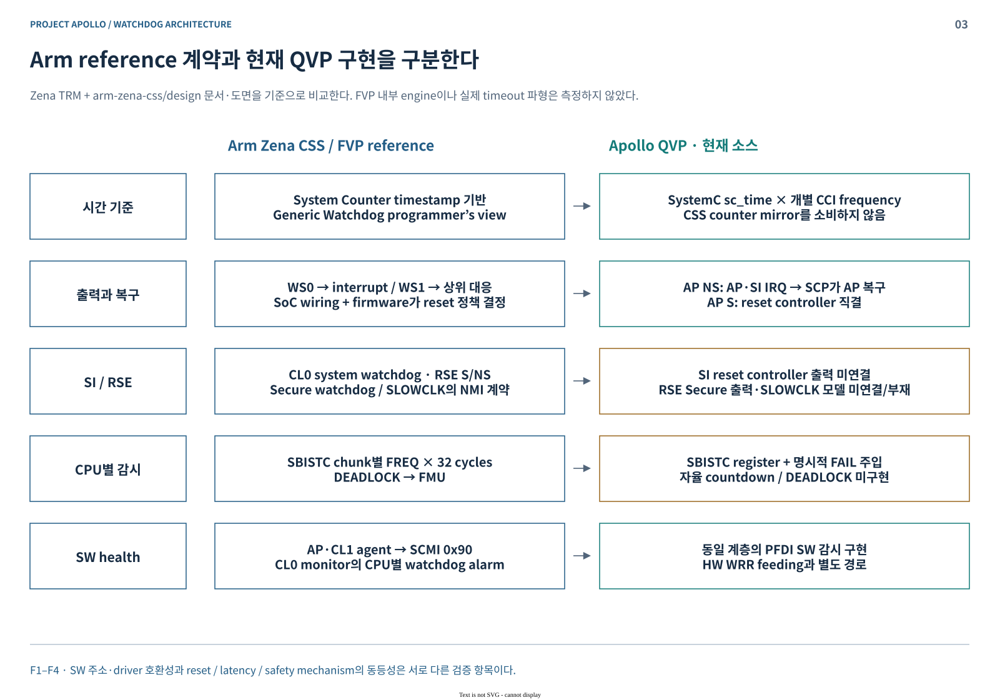
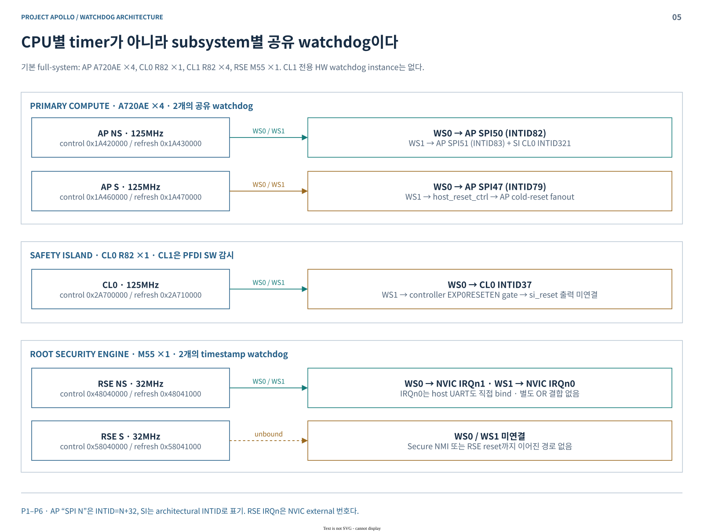
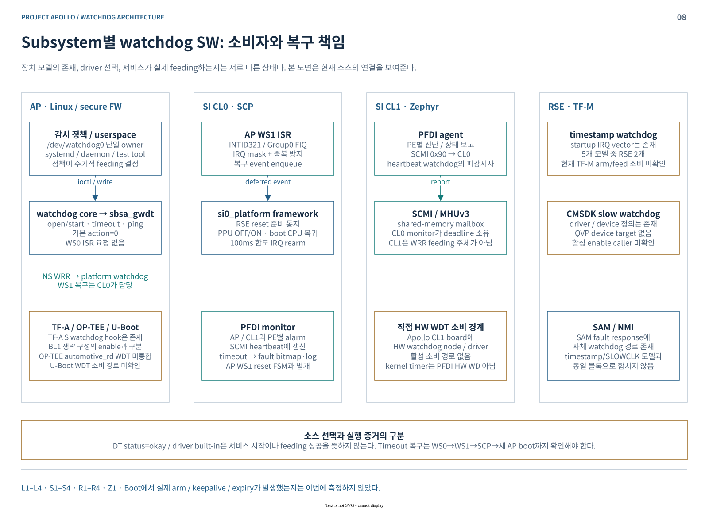
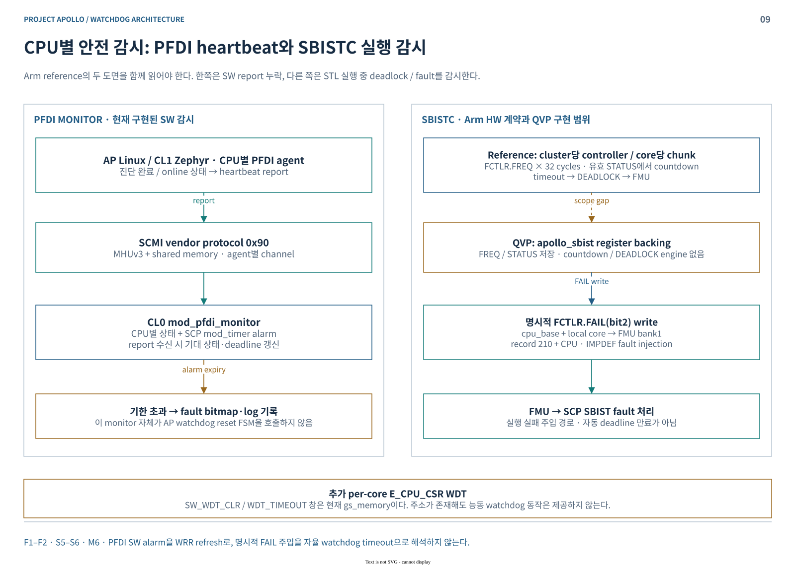

# Project Apollo Watchdog Architecture

**Phase1 기술 세미나 · 2026-10-18 · Apollo QVP / Cfg2**

**Watchdog의 만료와 시스템 복구는 서로 다른 단계다.** Apollo QVP의 AP Non-secure watchdog은 `WS1 → SI CL0 interrupt → SCP recovery → RSE BL2 재적재 → AP 재기동`으로 이어진다. WS1을 곧바로 전체 SoC reset으로 읽으면 실제 구조를 놓친다.

- **Platform HW watchdog 5개**, **SBISTC의 코어별 실행 감시**, **PFDI의 SW heartbeat 감시**를 구분한다.
- 현재 소스와 최종 Lua descriptor를 조사했다. 이번 작업에서 watchdog 만료·부팅·reset 시험은 수행하지 않았다.
- 모든 도면은 white 테마의 native draw.io이며, 본문 SVG에도 편집 정보가 포함되어 있다.

[주소·배선·구현 상세표](WATCHDOG-MAP.md) · [근거 소스·검증 범위](SOURCES.md) · [draw.io 원본 — 11장](apollo-watchdog-architecture.drawio)

| 발표 순서 | 핵심 질문 |
|---|---|
| [1. HW 구조](#hardware) | refresh, deadline, WS0·WS1은 어떻게 연결되는가? |
| [2. FVP와 QVP](#comparison) | 참조 계약과 현재 구현의 차이는 무엇인가? |
| [3. QBox 구현](#implementation) | QEMU MMIO가 SystemC 만료·IRQ로 이어지는 원리는? |
| [4. CPU와 watchdog](#cpu) | 공유 장치·코어별 감시·reset 범위는 어떻게 나뉘는가? |
| [5. Subsystem SW](#software) | 누가 감시를 시작하고, 누가 복구를 수행하는가? |
| [6. HW → SW sequence](#sequences) | feeding 중단에서 AP 복귀까지 어떤 순서로 진행되는가? |

## 1. Watchdog HW 구조

Generic Watchdog은 timestamp와 deadline을 비교한다. 정상 SW가 **refresh**하면 감시 구간을 다시 시작한다. 첫 만료는 **WS0**, 추가 한 구간의 만료는 **WS1**이다. WS1은 상위 권한 interrupt 또는 reset에 연결할 수 있으며, 최종 대응은 SoC 통합 정책이다. [HW 근거](SOURCES.md#hardware)

| Register / 신호 | 역할 | 현재 QVP에서 주의할 점 |
|---|---|---|
| `WCS` | EN, WS0, WS1 상태 | write는 EN만 반영하고 두 stage를 clear |
| `WOR` / `WORU` | 한 watch period의 offset | 모델은 총 48-bit offset 사용 |
| `WCV` / `WCVU` | 64-bit compare value | **QVP write는 저장만 수행**; 절대 deadline 예약으로 동작하지 않음 |
| Refresh frame `WRR` | 서비스가 watchdog을 refresh | write data와 무관하게 stage clear·rearm |
| WS0 / WS1 | 두 단계의 level 출력 | IRQ EOI만으로 source level이 해제되지는 않음 |

현재 모델은 SP805/CMSDK의 LOAD·LOCK·INTCLR 구조가 아니다. `WOR / fWD`로 구간을 계산하는 SystemC 모델이며, 별도 lock key나 prescaler는 구현하지 않는다. [모델 근거](SOURCES.md#models)

**Linux 기본 `action=0`은 두 구간을 합쳐 timeout으로 사용한다.** `WOR = timeout × CNTFRQ / 2`이므로, driver의 CNTFRQ와 모델의 `fWD`가 같다면 timeout=20초일 때 WS0는 약 10초, WS1은 약 20초의 논리 기한이다. 선택적 `action=1`은 한 구간을 timeout으로 잡고 WS0에서 panic한다. 이 값은 host scheduling을 포함한 실측 latency가 아니다. [Linux 근거](SOURCES.md#linux)

## 2. ARM Zena CSS FVP와 Apollo QVP 비교

비교 기준은 Zena TRM, `arm-zena-css/documentation/design`의 SBISTC·PFDI·validation 문서 및 실제 도면이다. **FVP 내부 engine과 실행 파형은 조사하지 않았다.**

| 비교 항목 | Arm reference 계약 | 현재 Apollo QVP |
|---|---|---|
| Timebase | System Counter timestamp 기반 | watchdog별 `SystemC time × frequency`; CSS mirror와 독립 |
| AP NS 만료 | WS0·WS1 interrupt, 상위 SW 대응 | WS0→AP, WS1→AP+CL0; SCP가 복구 수행 |
| SI의 AP WD 입력 | INTID320–323 정의 | **NS WS1의 INTID321만 연결** |
| SI CL0 reset | system watchdog과 reset 제어 | WS1→controller까지 연결; `si_reset` 출력 미연결 |
| RSE 보호 | NS IRQ·reset mask, Secure/SLOWCLK NMI | NS IRQ0/1 연결; Secure 출력 미연결, SLOWCLK device 부재 |
| 코어별 감시 | SBISTC countdown→DEADLOCK→FMU | register·명시적 FAIL 주입; 자율 countdown 미구현 |
| 접근·reset domain | RSE PPC0, PD_AON, SYS/RSS reset | watchdog PPC filter 없음; local SYS/RSS fanout에 WD 제외 |

FVP machine 설정에서 watchdog clock/reset override는 찾지 못했다. 이것만으로 FVP의 실제 주파수를 QVP와 같다고 단정하지 않는다. Arm의 `watchdog` validation 항목도 **장치·driver·filesystem 접근 확인**이며 expiry/recovery 검증과 구분한다. [참조 문서·원본 도면](SOURCES.md#reference)

## 3. Apollo QVP QBox의 구조와 구현

### 3.1 모델과 시간의 소유

| 계층 | 실제 책임 |
|---|---|
| QEMU CPU / QBox initiator | guest load/store를 TLM MMIO로 전달; 정상 경로는 QEMU lock을 놓고 SystemC로 전환 |
| `zena_watchdog` | register·stage·generation·deadline wait 소유; `SC_THREAD(timer_thread)`가 만료 처리 |
| `signal_fanout` / Lua bind | WS 출력의 AP·SI 분배 또는 reset controller 연결 |
| QEMU GIC / NVIC | target instance lock 아래 GPIO 입력 처리; pending·priority·CPU exception 수행 |
| SCP / TF-M | timeout에 따른 복구 정책, firmware 재적재와 ACK 처리 |

현재 5개 장치는 모두 **SystemC `zena_watchdog`**다. QEMU `sbsa_gwdt`와 `cmsdk-apb-watchdog` 소스도 존재하지만 이 구성에서 선택하지 않는다. 따라서 QEMU의 `watchdog_perform_action()`을 현재 Apollo의 WS1 동작으로 설명하면 안 된다. [모델·bridge 근거](SOURCES.md#models)

### 3.2 만료와 취소

- 한 구간: `τ = ((WORU & 0xffff) << 32 | WOR) / fWD`.
- `SC_THREAD`는 `τ` 또는 rearm event를 기다린다. refresh/reset 시 generation을 바꿔 이전 wait를 무효화한다.
- 첫 만료: WS0를 올리고 WCV를 다음 구간의 deadline으로 갱신한다. 둘째 만료: WS1도 올린다.
- disable/reset: 두 출력을 내리고 pending wait를 무효화한다. Reset 유지 중 write는 무시한다.

**WCV는 현재 모델에서 scheduling source가 아니다.** 직접 WCV를 써도 예약은 바뀌지 않는다. 0 offset 또는 0 Hz는 정지 clock 대신 delta-cycle 만료로 처리한다. [register 상세](WATCHDOG-MAP.md#registers)

Linux `GETTIMELEFT`는 WCV에서 CPU generic counter를 뺀다. QVP watchdog과 CPU counter는 시간 소유자가 다르므로 **같은 125MHz 설정만으로 epoch·위상 일치를 보장하지 않는다**. 실제 time-left 오차·drift는 별도 측정 대상이다.

## 4. 각 CPU와 Watchdog 구조

| Domain / 기본 CPU 수 | 공유 platform watchdog | 실제 소비·대응 |
|---|---|---|
| AP A720AE ×4 | NS 1개 + S 1개 | Linux는 NS 장치를 사용; NS WS1 복구는 CL0 담당 |
| SI CL0 R82 ×1 | CL0 1개 | local WS0는 INTID37; AP WS1은 별도 INTID321 |
| SI CL1 R82 ×4 | 전용 instance 없음 | CL0 PFDI monitor가 CPU별 상태 감시 |
| RSE M55 ×1 | NS 1개 + S 1개 | NS WS0/1은 NVIC1/0; S 출력은 미연결 |

**Platform watchdog은 per-core Generic Timer PPI가 아니다.** AP NS 하나를 어느 CPU에서 접근하든 같은 장치 상태를 변경한다. AP 코어별 E_CPU_CSR WDT와 SBISTC는 별도 계층이다. [주소·IRQ 전체표](WATCHDOG-MAP.md)

### 4.1 Reset 범위

AP NS는 SCP의 coordinated warm-reset 절차를 사용한다. AP S WS1은 `host_reset_ctrl.ap_s_watchdog_reset`에 직접 연결된다. AP cold-reset fanout은 **두 AP watchdog을 먼저 clear하고 AP reset handshake를 진행**한다. 이 순서가 WS1 level을 남긴 채 CPU를 다시 풀어 주는 상황을 방지한다. [reset 근거](SOURCES.md#platform)

`linux-direct` profile은 SI fanout·복구 경로를 제거한다. AP-only에서 WS1을 확인한 결과를 full-system AP 복구 증거로 확장하지 않는다.

### 4.2 RSE의 통합 경계

RSE의 timestamp watchdog 2개와 `0x5802E000`의 CMSDK SLOWCLK watchdog은 다른 IP다. 현재 QVP의 RSE watchdog은 32MHz SystemC 모델이며 SLOWCLK 장치로 대체해서 설명하지 않는다.

NS WS1은 NVIC IRQ0만 연결되어 있다. Secure NMI·watchdog reset gate는 끝까지 연결되지 않는다. IRQ0에는 host UART도 직접 bind되어 있으므로, **명시적 OR 없이 다중 source를 연결한 영향** 역시 실행 확인이 필요하다. [RSE 배선·SW 근거](SOURCES.md#rse)

## 5. Subsystem별 Watchdog Software Architecture

### 5.1 AP — Linux와 secure firmware

**Linux:** DT `arm,sbsa-gwdt` → built-in `CONFIG_ARM_SBSA_WATCHDOG` → watchdog core → `/dev/watchdog*`. `open/start` 이후 서비스가 `write` 또는 `WDIOC_KEEPALIVE`로 WRR을 갱신한다. 기본 `action=0`은 WS0 IRQ handler를 요청하지 않는다.

DT·driver가 있어도 자동 feeding을 뜻하지 않는다. 조사한 owned Yocto 정책에서 자동 arm 설정을 찾지 못했으며, 실제 owner·systemd 정책·활성 상태는 guest에서 확인해야 한다. [Linux 소스](SOURCES.md#linux)

| Firmware | 확인된 경로 | 소비 범위 |
|---|---|---|
| TF-A | Secure WDT start/stop, 100ms 상수 | Apollo는 `NEED_BL1=0`, `RESET_TO_BL2=1`; 공통 BL1 start를 정상 boot 활성화로 볼 수 없음 |
| TF-A error handler | `sbsa_wdog_refresh(SBSA_SECURE_WDOG_BASE)` | 실제 주소는 **control WCS**; refresh frame WRR write와 구분 |
| U-Boot | 공통 WDT framework·driver 소스 | Apollo 선택·서비스 소비 경로 미확인 |
| OP-TEE | 공통 SP805 driver 소스 | automotive_rd platform WDT integration 없음 |

TF-A error handler는 함수명만 보면 refresh처럼 보이지만 `0x1A460000+0`에 1을 쓴다. QVP 모델에서는 WCS.EN write이므로 stage clear·enable이 발생한다. 이후 만료는 현재 WOR 값에 달린다. [firmware 근거](SOURCES.md#ap-firmware)

### 5.2 SI CL0 — SCP-firmware

AP WS1 복구는 **FIQ ISR에서 mask·event enqueue**, **framework 문맥에서 RSE·PPU 제어**로 나뉜다. CL0 자신의 watchdog을 주기적으로 feed하는 서비스와는 별개다.

복구의 핵심 순서는 `모든 AP core/cluster OFF → RSE BL2 재검증·재적재 ACK → context/mailbox 정리 → CPU0 ON → IRQ321 rearm`이다. RSE 실패 시 AP를 OFF로 유지하고 watchdog IRQ도 masked 상태로 남긴다. [SCP 소스](SOURCES.md#scp)

### 5.3 SI CL1 — Zephyr / PFDI agent

CL1은 CPU별 worker에서 진단을 수행하고 SCMI protocol `0x90`으로 CL0에 보고한다. 현재 Apollo board에서 직접 HW watchdog node·driver·feed 소비 경로는 확인되지 않았다. **CL1의 PFDI worker는 platform watchdog WRR을 갱신하는 태스크가 아니다.**

### 5.4 RSE — TF-M

TF-M은 AP 복구 시 BL2를 load/decrypt/hash/signature 검증하고 성공 후 ACK한다. RSE timestamp watchdog의 주기적 arm/feed 서비스는 확인되지 않았다. NS watchdog vector도 기본 weak handler이므로 정상 ISR 구현으로 소개하지 않는다.

CMSDK slow watchdog의 driver·device 정의와 SAM의 NMI response watchdog 정책은 존재한다. 각각 **SLOWCLK 모델 부재**, **별도 SAM IP 경로**와 구분한다. [TF-M 근거](SOURCES.md#rse)

### 5.5 CPU별 PFDI 감시와 SBISTC

| 감시 | 상태·trigger | 현재 QVP 대응 |
|---|---|---|
| PFDI monitor | `WAIT_FOR_OOR → WAIT_FOR_BOOT → WAIT_FOR_ONL`; 정상 report마다 deadline 갱신 | SCP timer alarm 만료→fault bitmap·log; 직접 reset 호출 없음 |
| SBISTC | Arm 계약: core별 STL 실행시간 초과→DEADLOCK | QVP는 FCTLR.FAIL write→FMU fault 주입; 자율 countdown 없음 |
| E_CPU_CSR WDT | core별 SW_WDT_CLR / WDT_TIMEOUT | 현재 `gs_memory` register 창; 능동 watchdog 로직 없음 |

현재 QVP recipe의 PFDI 진단 interval은 AP·CL1 모두 3초다. Online 감시 기한은 AP 60초, CL1 25초이며 HW watchdog의 Linux timeout과 무관하다. 이는 시뮬레이션용 SW 정책으로, 안전 요구의 FTTI를 입증하는 값이 아니다. [PFDI·SBISTC 소스와 정책표](WATCHDOG-MAP.md#monitoring)

## 6. Watchdog Sequence — HW에서 SW까지

### 6.1 정상 feeding과 AP NS 만료

1. 서비스가 장치를 열고 timeout을 설정한다. Driver는 WOR·EN을 설정한다.
2. 정상 상태에서는 WRR write가 두 stage를 clear하고 감시를 다시 시작한다.
3. Feeding이 끊기면 WS0→AP INTID82. 기본 action=0에는 Linux WS0 ISR이 없다.
4. 추가 한 구간 후 WS1→AP INTID83 + CL0 INTID321. 실제 복구는 CL0가 진행한다.

프로세스 종료만으로 feeding 중단을 단정하지 않는다. 비정상 close·magic close·nowayout에 따라 kernel watchdog core가 장치를 유지하거나 ping할 수 있다. [driver/core 근거](SOURCES.md#linux)

### 6.2 CL0 복구와 AP 재기동

| 단계 | 처리 | 완료 조건 |
|---|---|---|
| IRQ321 ISR | mask, 중복 방지, AP_WATCHDOG event | ISR에서 reload handshake를 수행하지 않음 |
| AP OFF | warm-reset flow에서 core·cluster PPU OFF | 모두 OFF 확인 후 RSE 요청 |
| RSE reload | BL2 load/decrypt/hash/signature 검증 | 기한 내 ACK; 늦은 ACK·이전 generation 배제 |
| AP ON | PFDI/context/trusted mailbox·SCMI·SDS 정리, CPU0 ON | reset fanout이 WD 출력을 먼저 내림 |
| IRQ rearm | pending clear·readback→recovery latch 해제→enable→재확인 | 재진입 ISR이 설정한 latch 보존; source asserted면 retry, 실패 시 mask 유지 |

현재 budget은 전체 control 30초, RSE reload 10초, IRQ rearm 100ms다. Poll은 10ms alarm이며 **실제 복구 latency나 안전 보장 시간은 아니다**. IRQ rearm 성공도 Linux boot 완료와 같지 않다. [복구 함수·검증 경계](SOURCES.md#scp)

**Phase1 설명의 범위:** 현재 구현·배선·SW 정책을 구분한 architecture 문서다. 만료→새 AP boot, SI/RSE 상태 유지, 반복 복구, time-left 정확도, FVP 동등성은 실행 증거로 별도 판단해야 한다. [검증 결과](SOURCES.md#validation)
