# Apollo Zephyr RTOS Implementation Report

<a id="overview"></a>

## 1. Overview

### 1.1 Purpose and Scope

Safety Island CL1의 Zephyr RTOS Component를 **소스·빌드 → Firmware Handoff → Kernel 초기화 → RTOS 실행 → Driver·Service** 순서로 설명한다.

- **대상:** Cortex-R82 기반 CL1에서 실행하는 Zephyr와 Apollo board integration.
- **Kernel 책임:** Thread scheduling, SMP, interrupt·time·memory·동기화 관리.
- **연계 범위:** RSE의 image loading, CL0 SCP의 core 기동, AP Linux와 HIPC, CL0와 PFDI 상태 전달.
- **실행 환경:** Apollo QVP를 기능 검증용 Machine으로 사용한다. 별도 TC397/vMCU용 Zephyr는 이 CL1 image와 독립된 Component다.

### 1.2 Zephyr RTOS Component Summary

| 항목 | Apollo CL1 구성 |
|---|---|
| Source version | Zephyr `4.1.0` |
| Architecture | ARM64 / Cortex-R82 / Armv8-R AArch64 |
| CPU | SMP, 최대 4개 core |
| Board | `apollo_qvp_safety_island_c1` |
| Image | Application·Kernel·Driver를 정적으로 link한 firmware |
| Memory | CL1 SRAM 8MiB, MPU 기반 memory attribute |
| System clock | Generic Timer, Counter 125MHz, 100 ticks/s, tickless |
| Console | PL011 UART, 115200 baud, Shell·deferred logging |
| AP 통신 | MHUv3 + shared memory + OpenAMP/RPMsg + Veth |
| CL0 통신 | PFDI Agent의 상태 전달 |
| Yocto recipe | `zephyr-demos-cl1` |

### 1.3 Glossary

| 용어 | 의미 |
|---|---|
| Thread / ISR | Scheduler가 실행하는 context / interrupt exception context |
| Cooperative / Preemptive | 일반 thread 선점을 제한 / priority에 따른 thread 선점을 허용 |
| SMP / IPI | 여러 CPU에서 공통 Kernel 실행 / CPU 간 interrupt |
| Init level | Device·subsystem 초기화 함수를 단계와 priority로 정렬하는 체계 |
| Devicetree | Build 시 device instance·resource·memory configuration을 생성하는 입력 |
| MPU | Memory region별 접근 권한·cache attribute 설정 |
| Tickless | 필요 시점에 다음 timer interrupt를 예약하는 system-clock 동작 |
| Workqueue | 제출된 work item을 thread context에서 실행하는 queue |
| HIPC / RPMsg | 이기종 processor 간 통신 / shared-memory message 전달 체계 |
| Resource table | Remote processor의 VirtIO device·vring 정보를 기술하는 구조 |
| PFDI | CPU 진단 실행 및 결과·상태 전달을 위한 firmware interface |

<a id="stack"></a>

## 2. Safety Island CL1 Software Stack Overview

### 2.1 Application·Service·Zephyr Kernel·Driver 구성

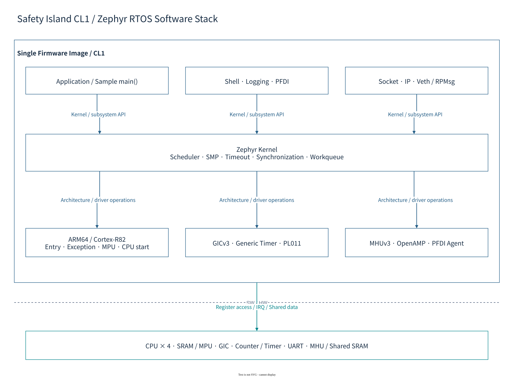

- Application·service는 Kernel API와 device/subsystem API를 직접 호출한다.
- Kernel은 runnable thread, timeout, synchronization object와 CPU 실행을 관리한다.
- Driver는 DT로 지정한 MMIO·IRQ·shared memory를 subsystem에 연결한다.
- Shell·network·PFDI는 각자의 thread 또는 workqueue에서 동작한다.

### 2.2 Zephyr Kernel의 역할과 책임

| 영역 | 주요 구성 | 제공 기능 |
|---|---|---|
| Scheduling | `kernel/sched.c`, `thread.c`, `smp.c` | Ready queue, context switch, CPU 간 실행 조정 |
| Time | `kernel/timeout.c`, `timer.c` | Timeout queue, sleep, timer callback |
| Synchronization | `sem.c`, `mutex.c`, `msg_q.c` | Wait/wakeup, lock, message 전달 |
| Deferred work | `kernel/work.c` | ISR·thread에서 제출한 작업의 후속 처리 |
| Memory | Stack, heap, slab, ARM MPU | 실행 context와 buffer 수명·region attribute |
| Device model | DT-generated instance, init entry | Driver 초기화·device ready 상태 |

### 2.3 Cortex-R82·ARM64·SMP 실행 환경

- Board DT는 MPID affinity `0x10000`, `0x10100`, `0x10200`, `0x10300`의 CPU를 기술한다.
- `CONFIG_SMP=y`, `CONFIG_MP_MAX_NUM_CPUS=4`로 common Kernel을 실행한다.
- CPU별 exception/interrupt state, stack, timer와 scheduler context를 준비한다.
- 현재 구성은 MPU를 사용한다. 기존 build config의 `CONFIG_USERSPACE`는 비활성이다.

Primary 선출은 reset entry의 voting으로 수행한다. 물리 CPU0가 항상 primary라고 가정하지 않는다.

### 2.4 RSE TF-M·CL0 SCP·AP Linux와의 역할 분담

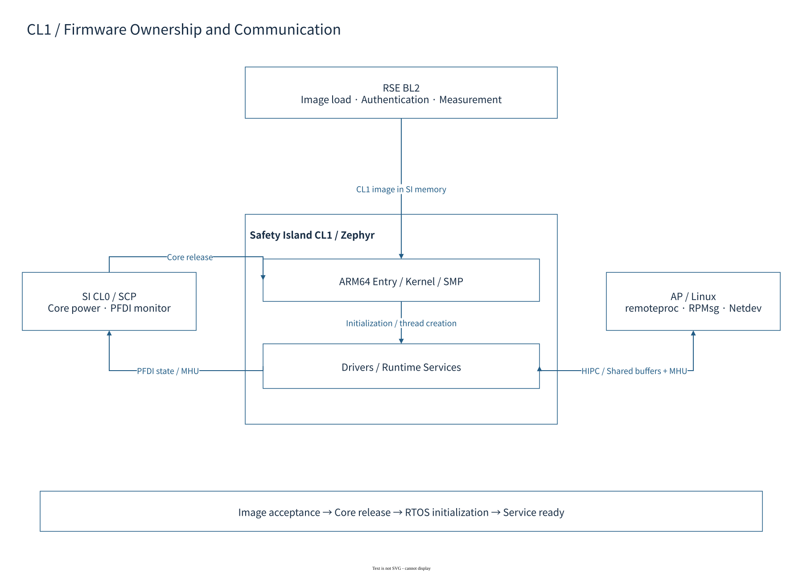

| Component | CL1과의 관계 |
|---|---|
| RSE BL2 | Zephyr image를 SI memory에 적재하고 인증·측정 |
| SI CL0 SCP | CL1 core power domain 기동, 실행 상태 감시 |
| CL1 Zephyr | 자체 Kernel·driver·service 초기화와 runtime 실행 |
| AP Linux | 이미 기동한 CL1에 remoteproc attach, RPMsg/Veth 통신 |

Linux의 HIPC attach는 CL1의 최초 firmware loading 단계가 아니다.

### 2.5 Firmware Image와 Runtime Thread 구성

Application, Kernel, driver와 선택 module이 하나의 image를 구성한다. Runtime에서는 main·idle·workqueue·shell·network·PFDI thread가 서로 다른 실행 context를 가진다.

`apps/sample/src/main.c`는 `return 0`만 수행한다. 주요 기능의 기동점은 `SYS_INIT`, device init, static thread와 service의 `k_thread_create()`다. Main 반환 뒤에도 해당 thread들은 계속 실행한다.

<a id="source"></a>

## 3. Zephyr Source and Build Architecture

### 3.1 Source Repository 및 Directory Structure

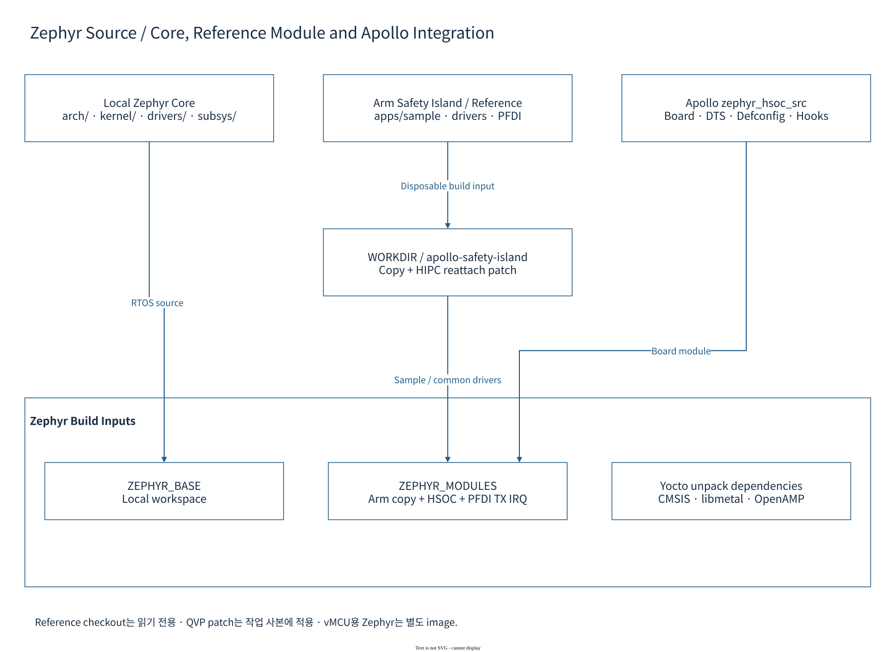

```text
hsoc-stack/components/system_mgmt/zephyrproject/
├── zephyr/                         # RTOS core / ARM64 / common drivers
│   ├── arch/arm64/                 # Entry, exception, MPU, SMP
│   ├── kernel/                     # Scheduler, timeout, synchronization
│   ├── drivers/                    # GIC, timer, UART 등
│   ├── subsys/                     # Network, shell, logging
│   ├── soc/arm/fvp_aemv8r/         # CRC hook, simulated CPU PM
│   └── include/zephyr/             # Kernel / driver API
└── zephyr_hsoc_src/                # Apollo-owned integration module
    ├── boards/hsoc/                # QVP / FVP board
    ├── overlays/                   # FVP feature configuration
    ├── samples/                    # 별도 진단용 application
    └── zephyr/module.yml           # Board root / Kconfig / CMake 등록

arm-zena-css/components/safety_island/zephyr/src/
├── apps/sample/                    # CL1 application entry
├── drivers/                        # MHUv3, Veth RPMsg, PFDI
├── subsys/pfdi/                    # PFDI management / shell
├── lib/pfdi/                       # CPU-test fallback implementation
└── soc/                            # Shared SoC/linker integration
```

### 3.2 Zephyr Core·Arm Safety Island Module·Apollo 확장 소스

| Source 영역 | 책임 | Build 입력 |
|---|---|---|
| Local `zephyr/` | RTOS 및 ARM64 공통 구현 | `ZEPHYR_BASE` / local workspace |
| Arm Safety Island module | HIPC·PFDI·sample application | Reference module 또는 작업 사본 |
| `zephyr_hsoc_src` | Apollo board·DTS·defconfig·timer/network hook | `ZEPHYR_MODULES` |
| CMSIS / libmetal / OpenAMP | Architecture·shared-memory/RPMsg 기반 | Yocto unpack dependency tree |
| `pfdi-tx-irq` | QVP PFDI TX IRQ 연동 | Owned recipe의 추가 module |

QVP recipe는 Arm module을 `${WORKDIR}/apollo-safety-island`에 복사하고 HIPC reattach patch를 적용한다. Reference checkout 자체를 수정하는 빌드 흐름이 아니다.

### 3.3 Board·SoC·Devicetree 구성

- **Board:** CPU topology, SRAM, GIC, timer, UART, mailbox·shared memory를 기술한다.
- **SoC:** `fvp_aemv8r` ARM64 지원을 사용하며 CRC·per-core hook·CPU-start operation을 연결한다.
- **Module registration:** `module.yml`이 board root, DTS root, Kconfig와 CMake 진입점을 등록한다.
- **Generated DT:** `zephyr.dts`와 generated header가 compile 시 driver resource·instance를 결정한다.

Device Tree는 이 image의 build 입력이다. Linux의 boot-time DT 탐색·driver binding과는 초기화 방식이 다르다.

### 3.4 Kconfig·Board Defconfig·Application Configuration

| 설정 입력 | 적용 내용 |
|---|---|
| Board defconfig | SMP4·timer·UART·HIPC·network·PFDI·shell |
| Application `prj.conf` | 현재 sample에는 별도 기능 설정 없음 |
| QVP recipe | Board 선택, PFDI period override; feature overlay 제거 |
| FVP recipe | FVP board 및 HIPC·Zperf·PFDI overlay 선택 |
| `${B}/zephyr/.config` | Kconfig 의존성을 반영한 최종 compile 설정 |

QVP의 기능 설정은 board defconfig/DTS에 통합되어 있다. `PFDI_MONITOR_SUPPORT=0`만으로 QVP board의 CL1 Agent가 비활성화되는 구조는 아니다.

### 3.5 CMake·Zephyr Module·Yocto Recipe 통합

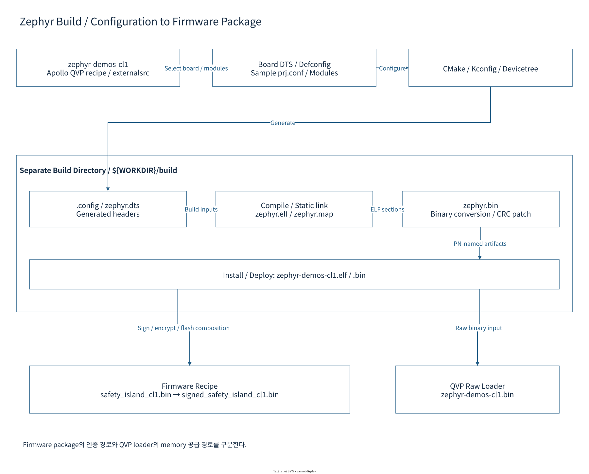

1. `zephyr-demos-cl1.bbappend`가 Machine별 Apollo include를 선택한다.
2. `externalsrc`가 local Zephyr workspace를 연결하고 `${WORKDIR}/build`에 output을 분리한다.
3. CMSIS·libmetal·OpenAMP를 unpack tree에서 선택한다.
4. QVP용 Arm module 사본에 reattach patch를 적용하고 HSOC·PFDI TX IRQ module을 연결한다.
5. CMake가 board·Kconfig·DT·module을 해석하고 generated source/header를 만든다.
6. Compile·link 후 binary와 image-integrity data를 생성하고 firmware packaging에 전달한다.

`zephyr_hsoc_src/config/apollo-cl1-modules.list`는 local FVP 빌드의 module 순서를 기술한다. QVP Yocto recipe의 최종 module 목록은 common include의 필터·추가 로직으로 확인한다.

### 3.6 Linker Layout·Memory Region·Resource Table

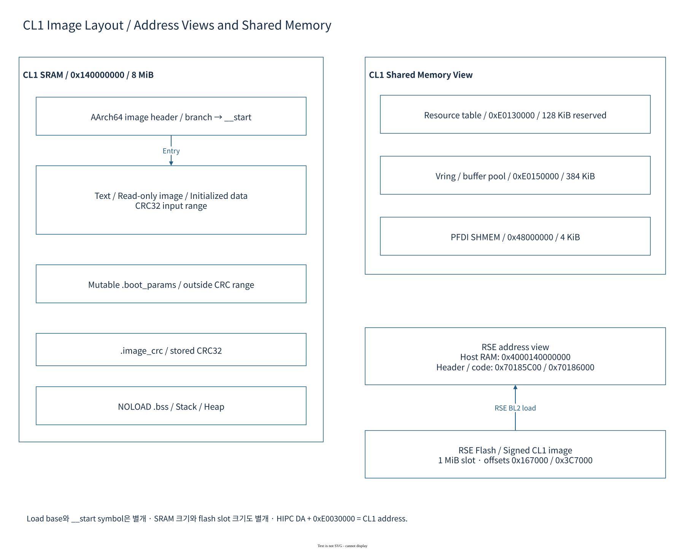

| 영역 | CL1 주소 / 크기 | 용도 |
|---|---|---|
| SRAM | `0x140000000`, 8MiB | Zephyr code·data·BSS·stack·heap |
| HIPC shared region | `0xE0130000`, 512KiB | Resource table·vring·packet buffer |
| Resource table | `0xE0130000`, 128KiB 예약 | AP가 확인하는 VirtIO/RPMsg metadata |
| RPMsg shared data | `0xE0150000`, 384KiB | Vring0·vring1·buffer 영역 |
| PFDI shared SRAM | `0x48000000`, 4KiB | CL0로 전달할 SCMI-format message |

Image 선두의 AArch64 header가 `__start`로 branch한다. SRAM base와 ELF의 `__start` symbol 주소를 동일시하지 않는다. Linker는 mutable `.boot_params`와 `.image_crc`를 CRC 계산 대상에서 제외한다. 현재 CRC patcher는 binary 끝 52 bytes를 제외하고 마지막 4 bytes에 CRC32를 기록한다.

주소는 CL1 view다. AP가 보는 HIPC physical address와는 address translation 관계를 갖는다. Resource table 예약 영역 전체가 table 구조체 크기인 것은 아니다.

### 3.7 Build and Deploy Artifacts

`zephyr.elf → zephyr.bin(CRC patch) → zephyr-demos-cl1.bin → safety_island_cl1.bin → signed_safety_island_cl1.bin → rse-flash-image.img`

| 산출물 | 소비 / 용도 |
|---|---|
| `zephyr.elf` | Symbol·section·debug 정보가 있는 ELF |
| `zephyr.bin` | Load 가능한 firmware payload |
| `zephyr.map` | Code/data 배치·memory 사용량 분석 |
| `.config`, `zephyr.dts` | 최종 compile 설정·DT 기록 |
| Generated headers | Kconfig·Devicetree를 C source와 연결 |
| `zephyr-demos-cl1.elf/.bin` | Recipe가 `/firmware`에 설치하고 deploy하는 이름 |
| `safety_island_cl1.bin` | Firmware recipe의 signing input |
| `signed_safety_island_cl1.bin` | MCUboot 형식의 signed/encrypted CL1 payload |
| `rse-flash-image.img` | CL1을 포함한 최종 RSE flash image |

Zephyr compile 결과와 RSE flash composition은 별도 단계다. Symbol ELF·binary·서명 payload가 같은 revision의 결과인지 맞춰 사용한다.

<a id="boot"></a>

## 4. Zephyr Boot Architecture

### 4.1 End-to-End Boot Flow 및 Component별 책임

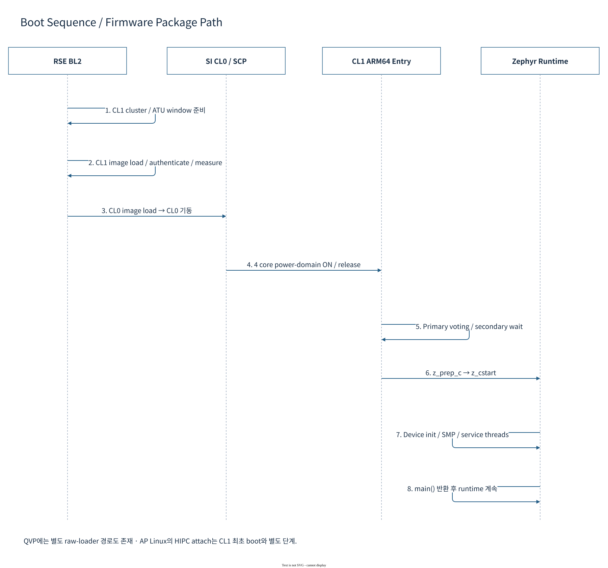

1. RSE BL2가 CL1 cluster 접근과 image destination을 준비한다.
2. RSE가 CL1 image를 적재·인증·측정한다.
3. RSE가 CL0 image를 준비하고 CL0 SCP를 기동한다.
4. SCP가 CL1의 4개 core power domain에 ON을 요청한다.
5. CL1의 ARM64 entry가 primary와 secondary 경로를 나눈다.
6. Zephyr가 Kernel·device·SMP·service를 준비한다.
7. AP Linux가 별도 boot 후 HIPC attach를 수행한다.

CL1의 자체 boot와 AP 통신 준비 완료는 서로 다른 시점이다.

| Image 공급 경로 | 현재 구성 |
|---|---|
| Firmware package / RSE BL2 | Signed CL1 image를 RSE flash에서 적재·인증 |
| Apollo QVP loader | Cluster `power_on_load`에 연결된 loader가 raw `zephyr-demos-cl1.bin`을 `0x140000000`에 적재 |

두 경로를 구분한다. QVP loader의 `authenticated_image` capability는 접근 정책 태그이며 crypto 검증 결과가 아니다. RSE write와 loader write의 실제 실행 순서는 boot trace로 확인한다.

### 4.2 RSE BL2의 Zephyr Image 적재·인증·측정

| 단계 | RSE 처리 |
|---|---|
| Pre-load | CL1 cluster PPU 전원 상태 준비, ATU로 header/code memory 매핑 |
| Image load | RSE flash의 CL1 image를 SI memory로 적재 |
| Authentication | Image 형식·서명·복호화 정책에 따른 검증 |
| Measurement | Boot measurement 기록 |
| Post-load | 임시 image header 정리, ATU mapping 해제 |

RSE의 cryptographic authentication은 Zephyr entry에서 수행하는 CRC와 별도 단계다.

| 주소 / 크기 | 값 | 의미 |
|---|---|---|
| CL1 execution RAM | `0x140000000` | CL1 local load base |
| RSE host physical RAM | `0x4000140000000` | RSE에서 접근하는 CL1 SRAM |
| RSE logical header / code | `0x70185C00` / `0x70186000` | ATU window; CL1 execution address와 별개 |
| CL1 flash slot | 1MiB | 8MiB 실행 SRAM과 다른 image partition 크기 |
| Primary / secondary offset | `0x167000` / `0x3C7000` | RSE flash 내 signed image 배치 |

### 4.3 SCP의 CL1 Power-on 및 CPU Release

- `safety_island_start()`가 CL1 초기화 경로를 시작한다.
- `init_si_cluster_cores()`가 각 core의 power-domain ON을 요청한다.
- Core가 reset entry를 실행한 뒤 Zephyr의 boot coordination에 참여한다.

SCP의 core 기동 요청과 Zephyr scheduler가 CPU를 사용하는 시점은 동일하지 않다.

### 4.4 ARM64 Entry·Primary CPU 선출·C Runtime 초기화

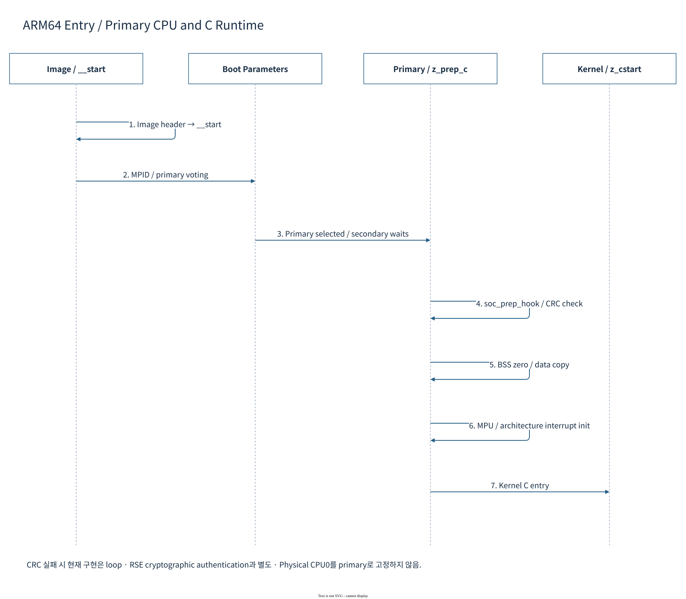

1. `__start`가 reset 상태·MPID와 초기 실행 context를 준비한다.
2. `arm64_cpu_boot_params` voting으로 primary를 선출한다.
3. Primary는 `z_prep_c()`로 진입한다. Secondary는 자신의 boot parameter를 기다린다.
4. `soc_prep_hook()` 이후 BSS zero·data copy를 수행한다.
5. ARM64 memory·interrupt 초기화를 거쳐 `z_cstart()`로 진입한다.

CPU ID를 논리 index와 MPID affinity로 나누어 설명한다. Board의 `cpu@0` 표기만으로 primary 선출 결과를 판단하지 않는다.

### 4.5 Image CRC Check·MPU·Cache·Interrupt 초기화

| 처리 | 구현 / 결과 |
|---|---|
| Image CRC | `soc_prep_hook()`의 image integrity check; 실패 시 현재 소스는 loop에 머묾 |
| BSS / data | `z_bss_zero()`, `z_data_copy()`로 C runtime 상태 구성 |
| MPU / memory | `z_arm64_mm_init(true)`가 memory region·attribute 준비 |
| Interrupt | `z_arm64_interrupt_init()`가 architecture interrupt 기반 구성 |
| CPU별 상태 | Secondary에서도 architecture·interrupt state를 개별 준비 |

Shared SRAM은 non-cacheable, device register는 IO attribute로 구분한다. CRC 성공을 서명 검증 또는 기능 안전 진단 완료로 해석하지 않는다.

### 4.6 `z_cstart()`와 Kernel Initialization Levels

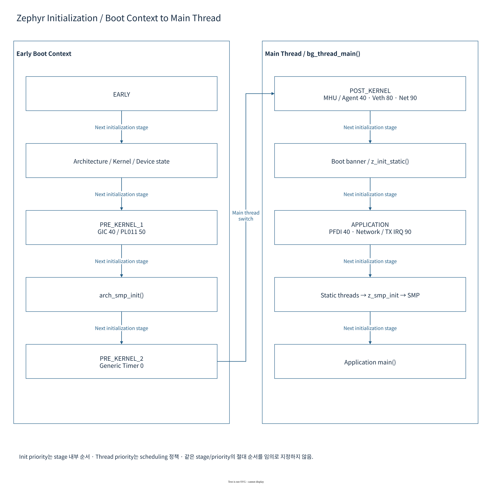

| 실행 context | 순서 | 처리 |
|---|---|---|
| 초기 boot context | `EARLY` | Architecture 초기화 이전 hook |
| 초기 boot context | Architecture / device state | Kernel 객체·CPU·device 상태 기반 구성 |
| 초기 boot context | `PRE_KERNEL_1` | Thread scheduling 이전의 초기 driver |
| 초기 boot context | `arch_smp_init()` | SMP architecture 기반 준비 |
| 초기 boot context | `PRE_KERNEL_2` | 추가 early initialization |
| Main thread | `POST_KERNEL` | Kernel service를 사용할 수 있는 driver·subsystem 초기화 |
| Main thread | `APPLICATION` | Board hook·runtime service 초기화 |
| Main thread | Static threads → `z_smp_init()` → `SMP` | Static thread 준비·secondary CPU 합류·SMP init entry |
| Main thread | `main()` | Application entry |

| Driver / service | Init level / priority |
|---|---|
| GICv3 / PL011 | `PRE_KERNEL_1 / 40`, `PRE_KERNEL_1 / 50` |
| Generic Timer | `PRE_KERNEL_2 / 0` |
| MHUv3 / PFDI Agent | `POST_KERNEL / 40` |
| Veth / Network stack | `POST_KERNEL / 80`, `POST_KERNEL / 90` |
| PFDI management | `APPLICATION / 40` |
| Network hook / TX IRQ hook | `APPLICATION / 90` |

값은 기존 build config 기준이다. 같은 level·priority의 항목에 임의의 선후 순서를 부여하지 않는다. 동일 level에서는 숫자가 작은 init priority가 먼저 실행된다. Init priority와 scheduler thread priority는 다른 값이다. `POST_KERNEL/APPLICATION` 함수가 반환했다고 remote peer나 network 연결까지 준비된 것은 아니다.

### 4.7 SMP Secondary CPU Bring-up

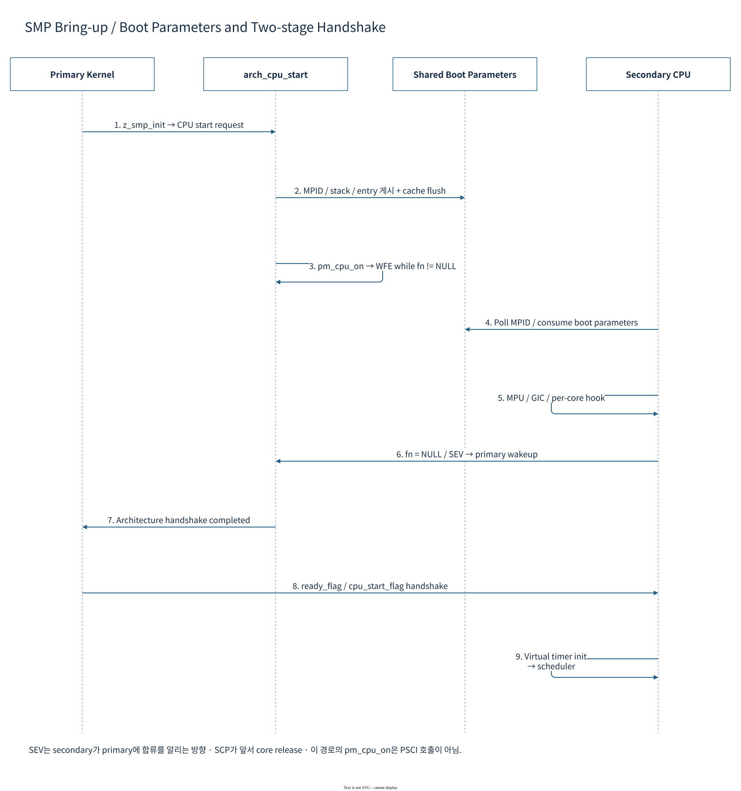

1. `z_smp_init()`가 secondary CPU 시작을 요청한다.
2. `arch_cpu_start()`가 MPID·stack·entry parameter를 게시하고 cache를 정리한다.
3. Primary는 simulated `pm_cpu_on()` 뒤 `fn`이 clear될 때까지 `WFE`로 기다린다.
4. 이미 release된 secondary는 MPID를 polling하다 자신의 순서에 MPU·GIC·per-core hook을 초기화한다.
5. Secondary가 `fn=NULL`을 게시하고 `SEV`로 primary를 깨워 architecture handshake를 완료한다.
6. `smp_init_top()`의 ready/start flag handshake 뒤 `smp_timer_init()`과 scheduler로 진입한다.

현재 구성은 `CONFIG_PM_CPU_OPS_PSCI=n`이다. 이 `pm_cpu_on()` 구현은 실제 PSCI power-on 요청을 수행하지 않으며, hardware core release는 앞선 SCP 단계가 담당한다.

### 4.8 Main Thread·Static Thread·Application 진입

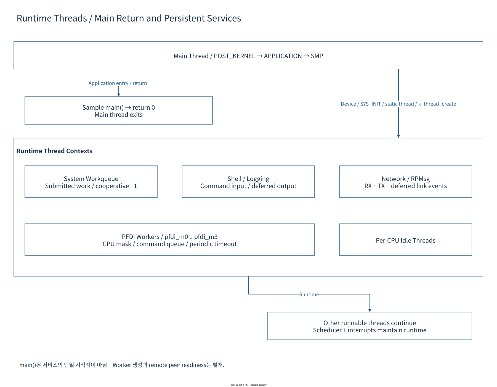

- Main thread의 `bg_thread_main()`이 후기 init level과 SMP 초기화를 수행한다.
- `K_THREAD_DEFINE` 계열의 static thread와 service의 동적 thread는 각자의 priority·시작 조건을 가진다.
- Sample `main()`이 반환하면 main thread의 실행은 종료된다.
- Idle·shell·logging·workqueue·network·PFDI thread는 runtime을 유지한다.

Main 진입·반환을 service의 단일 시작·종료 신호로 사용하지 않는다.

<a id="kernel"></a>

## 5. Zephyr RTOS Kernel Architecture

### 5.1 Kernel Object 및 Thread Execution Model

| Object / context | 동작 |
|---|---|
| `k_thread` | Stack·priority·entry·state를 가진 scheduler 대상 |
| Ready / Running | 실행 가능 / CPU에서 실행 중 |
| Pending / Sleeping | Object·timeout 조건을 기다림 |
| ISR | Interrupt 원인 처리; blocking API 사용 불가 |
| Idle thread | Runnable task가 없을 때 CPU별 실행 |

Wakeup은 thread를 runnable로 만든다. 실제 실행 시점은 priority·CPU mask·scheduler 상태에 따라 결정된다.

### 5.2 Scheduler·Priority·Cooperative/Preemptive Scheduling

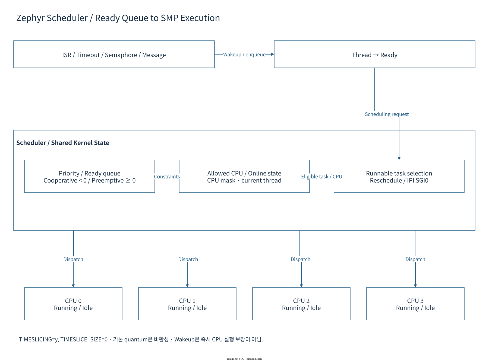

| 설정 / 정책 | 의미 |
|---|---|
| Priority | 숫자가 작을수록 높은 thread priority |
| Cooperative | 음수 priority; block/yield 전까지 일반 thread 선점 제한 |
| Preemptive | 0 이상 priority; 더 높은 priority의 ready thread가 선점 가능 |
| `CONFIG_SCHED_DUMB=y` | 기존 build config의 단순 ready-queue 구현 |
| `CONFIG_TIMESLICING=y` | Time-slicing 기능 포함 |
| `CONFIG_TIMESLICE_SIZE=0` | 기존 config의 기본 time slice는 비활성; 기능 포함과 실제 slicing을 구분 |

Cooperative thread도 ISR에 의해 중단될 수 있다. `k_sched_lock()`은 모든 CPU와 interrupt를 멈추는 global lock이 아니다.

### 5.3 SMP Scheduling·CPU Affinity·IPI

- Shared Kernel의 runnable thread를 CPU별 실행 상태와 함께 관리한다.
- `CONFIG_SCHED_CPU_MASK=y`로 thread의 허용 CPU를 지정할 수 있다.
- 다른 CPU의 reschedule이 필요하면 scheduler IPI를 사용한다.
- CPU에 pin된 thread라도 interrupt·lock contention·cache 영향은 남는다.

PFDI worker의 CPU pinning과 일반 application thread의 scheduling policy는 별도로 관리한다.

### 5.4 Interrupt·ISR·Deferred Work·Workqueue

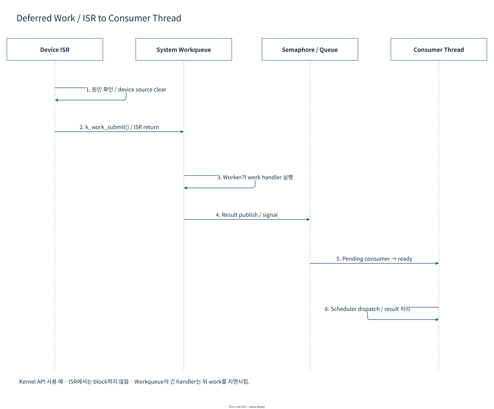

1. Device IRQ가 GIC를 통해 해당 CPU exception으로 들어온다.
2. ISR이 device 상태를 확인하고 필요한 원인을 clear한다.
3. 무거운 처리는 `k_work_submit()` 등으로 thread context에 넘긴다.
4. Workqueue thread가 work handler를 실행하고 semaphore·queue 등으로 consumer를 깨운다.

GIC EOI와 device source clear는 다른 처리다. Workqueue priority가 낮거나 한 handler가 오래 실행되면 같은 queue의 후속 work도 지연된다.

### 5.5 System Clock·Tickless Timer·Timeout·Sleep/Wakeup

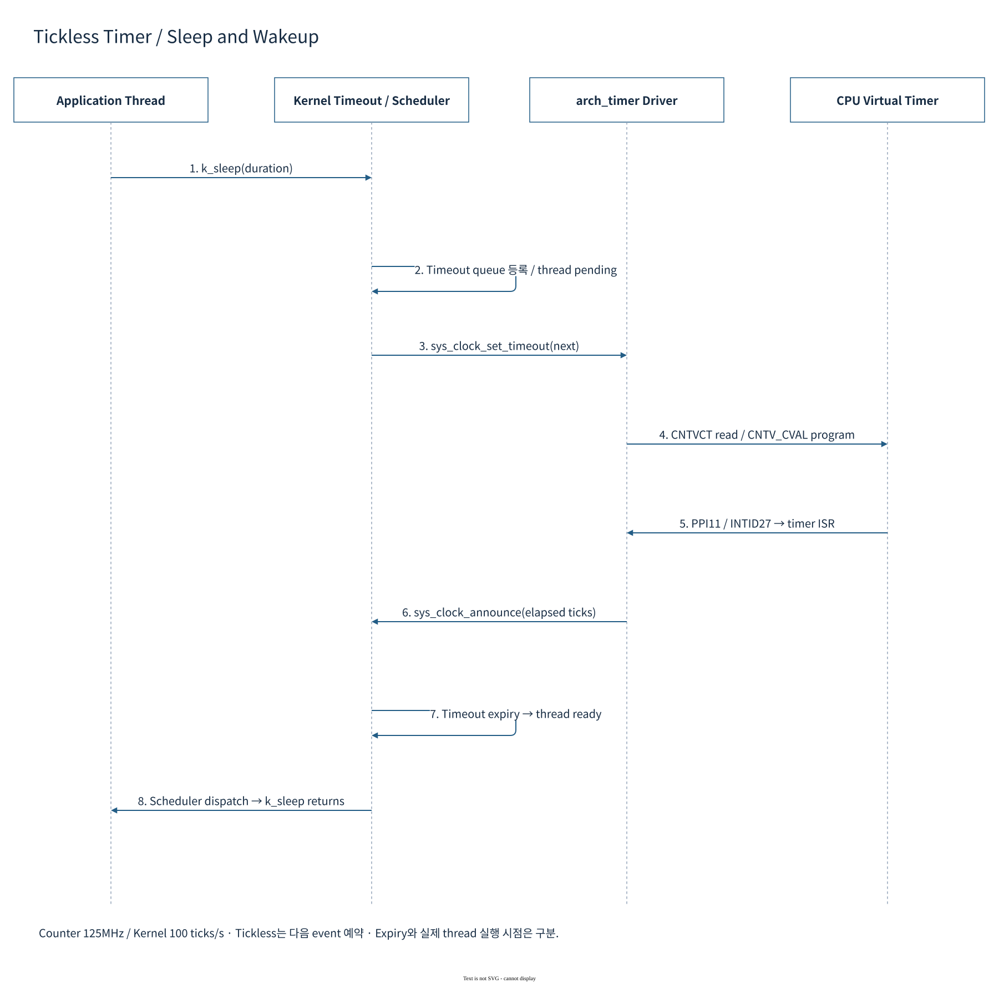

| 항목 | Apollo 구성 / 의미 |
|---|---|
| Counter frequency | `CONFIG_SYS_CLOCK_HW_CYCLES_PER_SEC=125000000` |
| Kernel tick | `CONFIG_SYS_CLOCK_TICKS_PER_SEC=100`, 1 tick = 10ms |
| Tickless | 다음 timeout에 맞춰 timer interrupt 예약 |
| Time read | `k_cycle_get_*`, uptime API; cycle와 tick 단위 구분 |
| Sleep | `k_sleep()` → timeout 등록 → thread 대기 → expiry 후 ready |
| `k_timer` | Expiry callback은 system clock interrupt context에서 실행 |

Counter의 cycle 분해능과 Kernel timeout의 tick 단위는 다르다. Timer callback에서 오래 실행하거나 block하지 않고 필요한 작업을 thread로 넘긴다. API 세부 구조는 [Timer Report](../timer/README.md#software)를 참조한다.

### 5.6 Semaphore·Mutex·Message Queue·Thread Synchronization

| API / object | 사용 목적 | Context 조건 |
|---|---|---|
| `k_sem` | Event·completion·resource count | ISR에서는 대기 없이 signal/허용 operation 사용 |
| `k_mutex` | Thread 간 공유 자원 보호·priority inheritance | Thread context 전용 |
| `k_msgq` | 고정 크기 message 복사·전달 | ISR 사용 시 `K_NO_WAIT` |
| FIFO / queue | Buffer ownership 전달 | Buffer 수명·producer/consumer 계약 필요 |
| `k_spinlock` | 짧은 SMP critical section | Lock 보유 중 sleep·긴 polling 금지 |

Priority inheritance는 mutex owner의 inversion을 줄인다. Semaphore나 모든 queue operation이 PI를 제공하는 것은 아니다.

### 5.7 Stack·Heap·MPU·Memory Protection

| 기존 build 설정 | 값 / 용도 |
|---|---|
| Main / Idle / ISR stack | 각각 4096 bytes; Idle/ISR의 CPU별 배치를 함께 확인 |
| System workqueue stack | 4096 bytes |
| Shell stack | 8192 bytes |
| PFDI worker stack | 4096 bytes / worker |
| System heap | 8192 bytes; OpenAMP 등 동적 allocation 사용 |
| MPU / userspace | `ARM_MPU=y`, `USERSPACE=n` |

MPU region은 RAM·device·shared-memory attribute를 구분한다. 현재 image의 모든 service를 독립 userspace process로 표현하지 않는다. Stack·heap 크기는 각 설정값과 최종 map/ELF를 함께 확인한다.

<a id="bsp"></a>

## 6. Apollo BSP / Device Driver Architecture

### 6.1 BSP·Board·SoC Support 구성

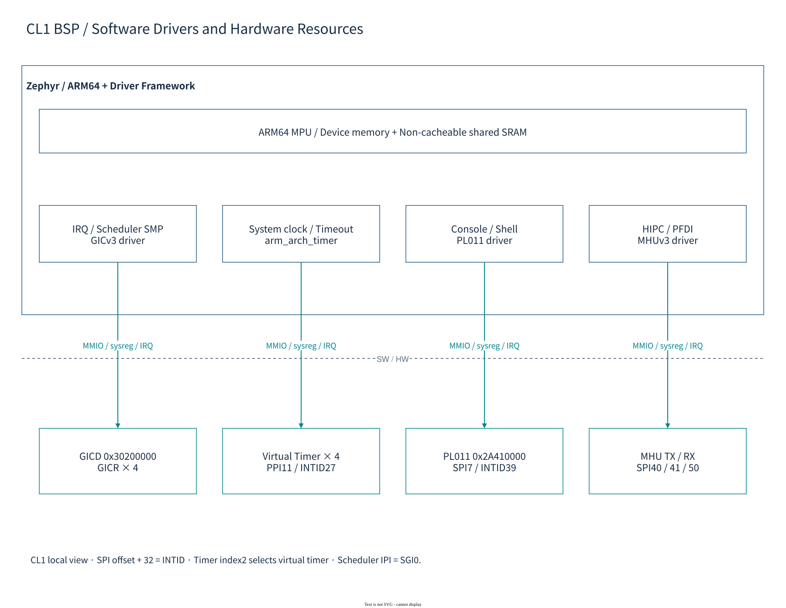

| 구성 | 소유 역할 |
|---|---|
| Board DTS / defconfig | 활성 device, resource, CPU·memory topology, 기능 설정 |
| ARM64 / SoC support | Entry·exception·MPU·CPU start operation |
| Zephyr common driver | GICv3, Generic Timer, PL011 |
| Arm module driver | MHUv3, RPMsg Veth, PFDI module/agent |
| Apollo board hook | Timer frequency 확인, interface·VLAN/IP 설정 |

### 6.2 Devicetree에서 Device Instance 생성까지

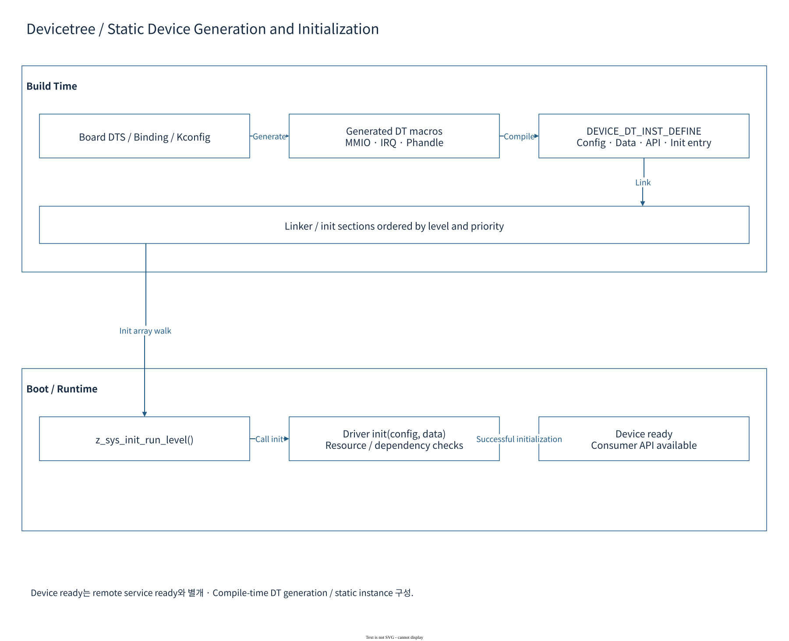

1. Board DTS·binding·선택 overlay로 최종 `zephyr.dts`와 C macro를 생성한다.
2. `DEVICE_DT_DEFINE` / `DEVICE_DT_INST_DEFINE` 계열이 config·runtime data·API·init entry를 선언한다.
3. Linker가 init entry를 level·priority별 section에 배치한다.
4. Boot code가 해당 level의 init function을 호출한다.
5. 성공한 device를 consumer가 `device_is_ready()` 등으로 확인한다.

`status = "okay"`와 Kconfig driver 선택을 모두 확인한다. Init entry 실행·device ready·remote communication ready는 서로 다른 상태다.

### 6.3 GICv3·Interrupt Routing·Per-CPU 초기화

- CL1 DT는 GICD `0x30200000`과 CPU별 GICR 영역을 기술한다.
- GIC driver가 interrupt enable·priority·routing과 CPU interface를 준비한다.
- GICR은 `0x30260000`, `0x30280000`, `0x302A0000`, `0x302C0000`에 배치된다.
- Scheduler IPI는 SGI0이다. Per-CPU timer interrupt와 CPU interface를 CPU별로 초기화한다.
- ISR dispatch 뒤 controller EOI와 device source 처리 순서를 맞춘다.

GIC 주소·interrupt wiring 상세는 [Interrupt Report](../interrupt/README.md#software)를 참조한다.

### 6.4 ARM Generic Timer 및 System Clock Driver

- `drivers/timer/arm_arch_timer.c`가 cycle read·timeout programming·tick announce를 연결한다.
- 현재 ARM64 경로는 `CNTVCT_EL0`, `CNTV_CVAL_EL0`, `CNTV_CTL_EL0`와 virtual timer **PPI11 / INTID27**을 사용한다.
- Secondary CPU의 `smp_timer_init()`도 comparator·IRQ를 준비한다.
- Timer ISR의 elapsed tick이 Kernel timeout queue로 전달된다.
- Board의 `si_timer_frequency_check()`가 `CNTFRQ_EL0`와 configured frequency를 비교한다.
- `APOLLO_SI1_TIMER ... status=PASS/FAIL`은 frequency 설정 일치 결과다.

Frequency 일치만으로 interrupt 지연·sleep 정확도·실시간 deadline이 검증되는 것은 아니다.

### 6.5 PL011 UART·Console Driver

| 항목 | 구성 |
|---|---|
| MMIO | `0x2A410000` |
| DT interrupt | `GIC_SPI 7`, level |
| Clock / baud | 24MHz / 115200 |
| Consumer | Console, serial shell, logging output |

UART 초기화 이후 shell thread와 logging processing이 각각 준비된다. 초기 printk 출력과 shell command 처리 가능 시점도 구분한다.

### 6.6 MHUv3 Mailbox Driver

| CL1 endpoint | MMIO | DT SPI offset | Consumer |
|---|---|---|---|
| CL1 → AP TX | `0x39000000` | 40 | RPMsg notify |
| AP → CL1 RX | `0x39040000` | 41 | RPMsg receive·attach/detach |
| CL1 → CL0 TX | `0x39200000` | 50 | PFDI Agent |

표의 값은 DT의 SPI offset이다. GIC architectural INTID는 SPI offset에 32를 더한 값이다. Doorbell은 data payload가 아닌 shared-memory 처리 알림이다.

### 6.7 Shared Memory·Cache Attribute·Memory Ordering

- HIPC resource table·vring·buffer 영역은 CL1 DT에서 non-cacheable region으로 구성한다.
- CL1 local address는 RPMsg device address에 `0xE0030000`을 더해 구한다. 예: AP `0x100000` ↔ CL1 `0xE0130000`.
- Shared payload publish와 doorbell 전송의 순서를 보장한다.
- Non-cacheable 설정이 buffer ownership·memory ordering 계약을 대체하지 않는다.

### 6.8 Driver 활성 설정 및 Device Ready 상태

| 기능 | 주요 설정 |
|---|---|
| Timer | `ARM_ARCH_TIMER=y`, `TICKLESS_KERNEL=y` |
| UART / Console | `UART_PL011=y`, `UART_CONSOLE=y` |
| Mailbox | `MBOX=y`, `MBOX_MHUV3=y` |
| RPMsg / Network | `OPENAMP=y`, `OPENAMP_RSC_TABLE=y`, `VETH_RPMSG=y` |
| Services | `SHELL=y`, `NET_ZPERF=y`, `PFDI_MGMT=y`, `PFDI_AGENT=y` |
| Logging | `LOG_MODE_DEFERRED=y` |

Board 입력과 기존 build `.config`를 대조한 값이다. Runtime device ready·IRQ 발생·message 전달 결과는 8장에서 기록한다.

<a id="services"></a>

## 7. Runtime Service and Inter-Processor Communication

### 7.1 Service Initialization·Worker Thread·Runtime 실행 구조

| Service | 기동점 / 실행 context |
|---|---|
| Shell | Serial backend 초기화 후 shell thread |
| Logging | Deferred log processing thread |
| Network / Veth | Device·network 초기화와 RX/TX processing |
| Board network setup | `SYS_INIT(si_net_init, APPLICATION, ...)` |
| PFDI Management | `SYS_INIT(pfdi_service_init, APPLICATION, ...)` → CPU별 worker |
| PFDI Agent | Device init·CPU test post-run hook·mailbox transfer |

서비스는 서로 다른 init priority·thread priority를 가진다. 한 service의 준비 완료를 전체 CL1 application ready로 확대하지 않는다.

### 7.2 Shell·Logging·진단 인터페이스

- Serial prompt와 `help`·`pfdi get-status 0` 등 활성 command로 shell 응답을 확인한다.
- 기존 `.config`의 `KERNEL_SHELL`·`THREAD_MONITOR`는 비활성이다. `kernel version`·`kernel threads` 제공을 기본값으로 가정하지 않는다.
- Network shell과 `zperf`가 interface·packet 통신을 검사한다.
- PFDI shell은 CPU별 상태·test selection·결과를 조회한다.
- Deferred logging은 caller와 출력 context를 분리하지만 buffer 용량과 출력 지연을 갖는다.

### 7.3 OpenAMP·RPMsg·Veth 기반 HIPC 구성

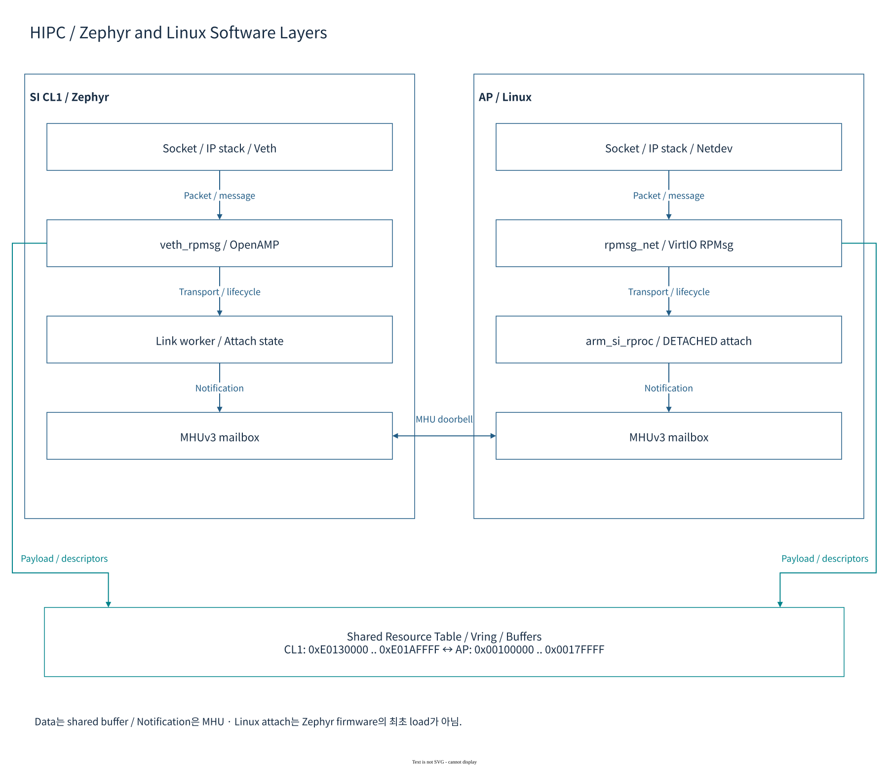

| Layer | CL1 Zephyr | AP Linux |
|---|---|---|
| Network | Socket·IP stack·Veth interface | Socket·IP stack·netdev |
| Packet/message | `veth_rpmsg` | `rpmsg_net` |
| Transport | OpenAMP / RPMsg / VirtIO | VirtIO RPMsg |
| Lifecycle | Veth attach/detach worker | `arm_si_rproc` attach |
| Notification | MHUv3 mailbox | MHUv3 mailbox |
| Shared state | Resource table·vring·buffer | Reserved-memory mapping |

RPMsg endpoint discovery와 network interface/IP 준비는 별도 단계다. Channel name `ethsi1`과 IP/VLAN 설정까지 맞아야 application traffic이 흐른다.

### 7.4 AP Linux와 Attach·Detach·Reattach Sequence

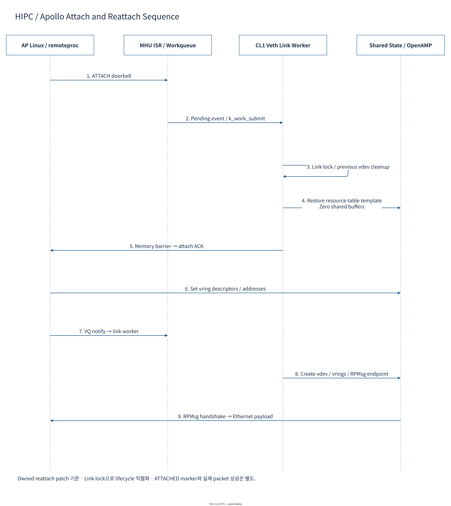

1. Linux가 MHU로 attach를 요청한다. ISR callback은 pending event를 기록하고 work를 제출한다.
2. Veth worker가 link lock을 획득하고 이전 VirtIO context를 정리한다.
3. Firmware private template에서 shared resource table을 복구하고 shared buffer를 초기화한다.
4. Memory barrier 뒤 attach ACK를 보낸다.
5. Linux가 vring을 구성하고 notify한다.
6. CL1이 OpenAMP vdev·vring·RPMsg endpoint를 만들고 `ATTACHED`로 전환한다.
7. RPMsg handshake와 network 설정 뒤 Ethernet payload를 처리한다.
8. Detach는 기존 context를 정리하며, 다음 attach에서 shared metadata 복구·ACK·endpoint 재생성을 반복한다.

Apollo QVP는 `veth-restore-resource-table-on-reattach.patch`를 작업 사본에 적용한다. 이전 Linux 세션이 바꾼 resource-table 상태를 다음 attach에 그대로 재사용하지 않도록 하는 변경이다.

### 7.5 Network Interface·IP/VLAN·Zperf 초기화

| 설정 | Board 기본값 |
|---|---|
| MAC / RPMsg service | `00:01:02:03:04:06` / `ethsi1` |
| CL1 IPv4 | `192.168.1.1/24` |
| AP peer | `192.168.1.2` |
| VLAN | 200 |
| Interface selection | Target index 2, clear index 1 |
| Auto-init | `NET_CONFIG_AUTO_INIT=n`; board hook이 설정 |

`si_net_init()`의 interface 선택·주소·VLAN 설정을 실제 생성된 interface와 대조한다. Zperf는 통신 동작과 guest 환경의 처리량을 확인하는 도구다.

### 7.6 PFDI Management·Agent 및 CL0 통신

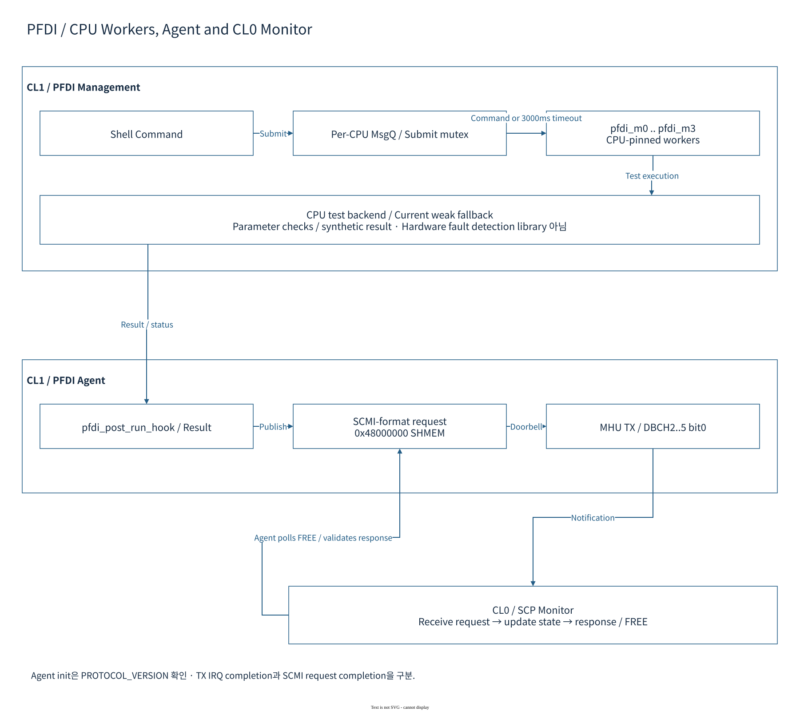

- Management service가 CPU별 worker를 만들고 지정 CPU에서 test를 실행한다.
- Worker 결과와 상태를 PFDI Agent가 shared-memory message로 구성한다.
- Core별 mailbox channel `64/96/128/160`은 DBCH `2/3/4/5`의 bit0이다.
- MHU notify 뒤 shared-memory `channel_status=FREE`를 polling하고 response를 검사한다. TX IRQ와 protocol completion은 별도다.
- QVP recipe가 period를 override하며 기본 integration 값은 3000ms다.

Agent 초기화는 CPU별 `PROTOCOL_VERSION` 요청/응답을 확인한다. Worker는 CPU별 queue에서 command를 기다리고 기본 3000ms timeout 때 test를 실행한다.

현재 공통 module에는 vendor CPU 진단 library를 대신하는 weak fallback이 있다. PFDI protocol·worker·결과 전달 시험과 실제 CPU fault-detection coverage는 다른 검증 항목이다.

### 7.7 Kernel Boot 완료와 Service Ready 조건

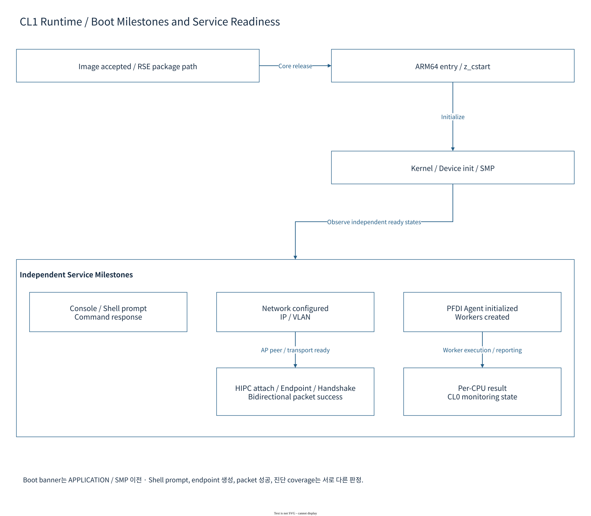

| Milestone | 확인 내용 |
|---|---|
| Image accepted | RSE image load·authentication 단계 완료 |
| Kernel entered | ARM64 entry·`z_cstart()` 실행 |
| Kernel initialized | Device init·SMP bring-up·main 경로 진행 |
| Console ready | Prompt와 활성 shell command에 응답 |
| HIPC ready | Attach·endpoint·interface·주소 준비 |
| Traffic ready | 양방향 packet 송수신 성공 |
| PFDI reporting ready | Agent protocol 초기화, CPU별 worker 결과와 CL0 상태 수신 확인 |

`PFDI service ready (4 CPUs)`는 worker 생성, `Network interface configured`는 interface 설정, `RPMSG Endpoint: ATTACHED`는 endpoint 생성의 marker다. 각각 실제 CPU test coverage·packet 송수신 결과와 구분한다.

Zephyr boot banner는 `POST_KERNEL` 이후 출력되며 `APPLICATION`·SMP·`main()`보다 이르다. Banner만으로 service ready를 판정하지 않는다.

<a id="validation"></a>

## 8. Test and Verification

### 8.1 검증 대상 Image·Configuration·실행 환경

CL1 ELF·binary·RSE flash payload·`.config`·generated DT를 같은 build로 맞춘다. CL1 console과 CL0/AP log를 함께 수집한다.

`PASS`: 기대 결과 충족 / `FAIL`: 불충족 / `NOT RUN`: 미실행 / `BLOCKED`: 선행 조건 문제 / `N/A`: 해당 구성에 미적용.

| 문서 작성 중 확인 항목 | 결과 |
|---|---|
| Zephyr version·board defconfig·DT·Yocto module 구성 | 소스 대조 완료 |
| RSE → SCP → Zephyr boot ownership·init level·SMP 경로 | 소스 대조 완료 |
| 기존 build config의 SMP·timer·MPU·thread 설정 | 설정 확인 |
| Build / runtime 재실행 | NOT RUN |

### 8.2 Firmware Handoff·Zephyr Boot 검증

| Test ID | 방법 | 기대 결과 | 실제 결과 | 판정 |
|---|---|---|---|---|
| ZEP-BOOT-01 | RSE load·authentication log와 CL1 ELF/image 대조 | 선택 image 기동 경로 일치 | — | NOT RUN |
| ZEP-BOOT-02 | CL0 core power-on log와 CL1 boot log 확인 | Core 기동 후 Zephyr entry 진행 | — | NOT RUN |
| ZEP-BOOT-03 | CL1 boot banner·prompt·`help` 확인 | 선택 image의 banner와 shell 응답 | — | NOT RUN |

기존 `si-cl1` probe는 `kernel version`을 요청한다. 현재 config에는 `KERNEL_SHELL`이 없어 이 probe의 command와 image 설정을 맞춰야 한다. 이 문서 작성에서는 설정·probe를 변경하지 않았다.

### 8.3 SMP·Timer 초기화 확인

| Test ID | 방법 | 기대 결과 | 실제 결과 | 판정 |
|---|---|---|---|---|
| ZEP-CORE-01 | SMP 설정, CPU별 PFDI worker/status와 CL0 log 대조 | 4-core 구성과 CPU별 실행 상태 일치 | — | NOT RUN |
| ZEP-TIME-01 | `APOLLO_SI1_TIMER` marker 조회 | `cntfrq=125000000`, configured 값 일치 | — | NOT RUN |
| ZEP-TIME-02 | CPU별 worker의 주기적 실행·상태 갱신 확인 | Timer 기반 runtime 진행 | — | NOT RUN |

Worker 상태 갱신은 시간 정확도나 worst-case scheduling latency의 측정 결과가 아니다.

### 8.4 Shell·Console·기본 Runtime 동작 검증

| Test ID | 방법 | 기대 결과 | 실제 결과 | 판정 |
|---|---|---|---|---|
| ZEP-CON-01 | `help`·`pfdi get-status 0` 반복 실행 | Shell 지속 응답·fatal exception 없음 | — | NOT RUN |
| ZEP-NET-01 | Network interface·IPv4/VLAN 조회 | Board 선택 interface와 주소 일치 | — | NOT RUN |

### 8.5 HIPC 연결 및 양방향 통신 검증

| Test ID | 방법 | 기대 결과 | 실제 결과 | 판정 |
|---|---|---|---|---|
| ZEP-IPC-01 | CL1/AP의 DT·reserved-memory·endpoint 상태 대조 | 양쪽 resource와 transport 설정 일치 | — | NOT RUN |
| ZEP-IPC-02 | 준비된 CL1/AP console에서 양방향 ping·Zperf UDP/TCP | Payload 송수신 성공 | — | NOT RUN |

기존 `test_31_si_cl1_hipc.py`는 packet·boundary·multistream 검증 내용을 제공한다. 다만 `qa-tests/profiles/hipc.yaml`은 FVP product 전용이며, QVP 자동 실행 profile로 간주하지 않는다. 위 QVP 항목은 각 console과 통신 도구를 사용한 기능 검증 범위다.

Reattach patch의 존재는 반복 attach 실행 결과가 아니다. Reattach 결과를 추가할 때는 각 cycle의 transport 재생성·packet 성공을 함께 기록한다.

### 8.6 PFDI Agent·CL0 연동 검증

`pfdi-si-cl1` profile은 **BSP image**용이며 FVP·QBox backend를 지원한다.

| Test ID | 방법 | 기대 결과 | 실제 결과 | 판정 |
|---|---|---|---|---|
| ZEP-PFDI-01 | `pfdi-si-cl1` profile의 CPU별 status/run/result | Worker·command·result 경로 동작 | — | NOT RUN |
| ZEP-PFDI-02 | 기존 invalid argument·forced error 시험 | 오류 처리와 상태 변경 일치 | — | NOT RUN |
| ZEP-PFDI-03 | CL0 monitor log와 CL1 Agent 상태 대조 | CPU별 상태 전달·monitor 반영 | — | NOT RUN |

Weak fallback 환경의 성공 결과는 vendor 진단 library나 hardware safety coverage 검증으로 기록하지 않는다.

### 8.7 검증 결과 및 실패 로그

| 기록 항목 | 내용 |
|---|---|
| Build identity | Source revision, ELF/binary hash, configuration |
| Execution | 실행 command, profile, CL1/CL0/AP log 위치 |
| Result | Test ID, 기대값, 실제값, PASS/FAIL/NOT RUN |
| Failure stage | Image load → core release → entry → init → SMP → service → traffic |
| Follow-up | 첫 실패 지점, 재현 조건, 수정 후 동일 시험 결과 |

[Source Reference](SOURCES.md) · [편집 가능한 draw.io 원본](apollo-zephyr-architecture.drawio)
